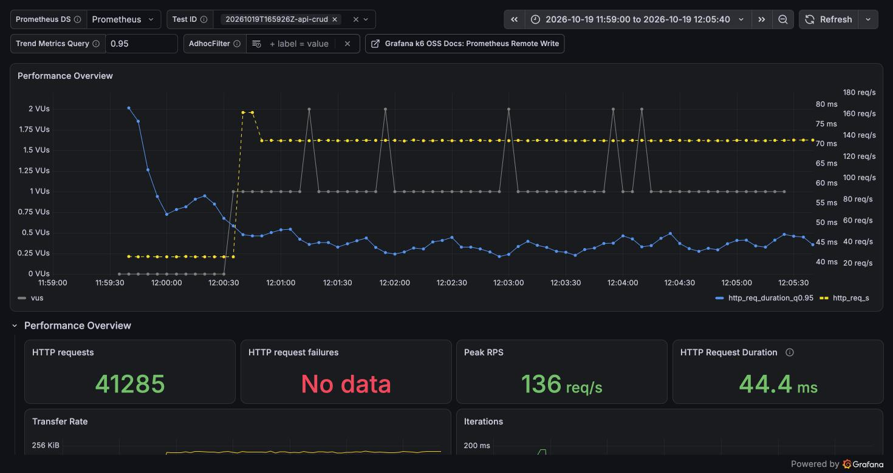
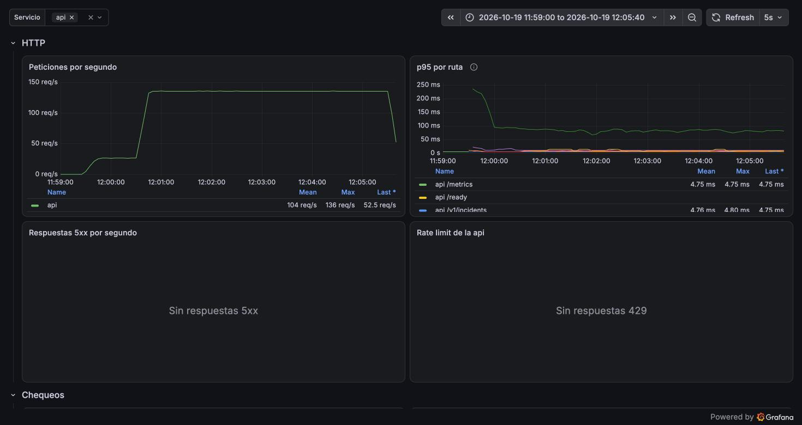

# Reporte de carga: api-crud (2026-10-19)

| Campo     | Valor                                                   |
| --------- | ------------------------------------------------------- |
| Fecha     | 2026-10-19 16:59 UTC                                    |
| Commit    | `92928be` (rama `test/loadtest-base`), imágenes release |
| testid    | `20261019T165926Z-api-crud`                             |
| k6        | 2.3.0 en contenedor, red de compose                     |
| Veredicto | **Pasa** todos los umbrales                             |

## Resumen

El panel de 50 tenants a 135 req/s responde con un p95 de 44 ms, muy por debajo del SLO de 300 ms.
No hubo errores, respuestas 429 ni iteraciones descartadas. La ruta más cara es
`GET /v1/monitors/:id/metrics` (p95 de 71 ms, p50 de 40 ms): cuesta unas diez veces más que el
resto de las lecturas, porque consulta 30 días de `check_results` en cada llamada. PostgreSQL usó
como máximo 3 conexiones activas, así que el pool de 10 no fue un límite.

## Máquina

| Campo          | Valor                                                   |
| -------------- | ------------------------------------------------------- |
| Equipo         | Apple M4, 10 núcleos, 16 GB                             |
| SO             | macOS 27.0.1                                            |
| Docker         | OrbStack 2.2.4 (Docker 29.8.2), VM con 10 CPU y 7,8 GiB |
| Dónde corre k6 | contenedor `grafana/k6:2.3.0` en la misma VM que Taut   |

## Configuración

- Imágenes release de `92928be` (`just loadtest-up`), con la configuración por defecto: pool de
  10 conexiones por servicio, `TAUT_CHECKS__CONCURRENCY` = 100, logs `info` y sin caché.
- Semilla por defecto (`just loadtest-seed`): 70 tenants, 450 monitores y 15 926 239 filas en
  `check_results`. Los 50 tenants `lt-p-*` tienen 5 monitores cada uno, con 30 días de historia a
  1 min.
- Carga de fondo: los 450 monitores sembrados se chequean contra el servidor eco, unos 5 por
  segundo (1 496 chequeos en la fase estable, lag p95 de 0,95 s y ninguno expirado).

## Escenario

`just loadtest api-crud` con los valores por defecto:

- `setup()` hace login de los 50 usuarios (uno por tenant).
- `warmup`: 1 min a 5 iteraciones de lectura por segundo, fuera de los umbrales.
- `reads` (fase estable): 5 min a 25 it/s. Cada iteración pide la lista de monitores, el detalle
  de uno, sus últimos 50 chequeos, sus métricas (24h 70 %, 7d 20 %, 30d 10 %) y los incidentes
  abiertos, y una de cada cuatro también la lista completa de incidentes.
- `writes` (fase estable): 5 min a 1 it/s. Cada iteración crea un monitor contra el eco, lo
  actualiza con PUT, lo pausa y lo borra.
- Cada iteración va a un tenant distinto, en rueda: unas 160 peticiones/min por tenant, el 27 %
  de su presupuesto de 600.
- Umbrales: p95 < 300 ms global y por ruta, p99 < 1 s, errores < 1 %, checks > 99 %, cero 429 y
  cero iteraciones descartadas.

## Resultados (fase estable, 300 s)

| Ruta                           | req/s |    p50 |     p90 |     p95 |     p99 |     max |
| ------------------------------ | ----: | -----: | ------: | ------: | ------: | ------: |
| `GET /v1/monitors`             |  25,0 | 2,3 ms |  3,4 ms |  4,4 ms |  6,3 ms | 39,7 ms |
| `GET /v1/monitors/:id`         |  25,0 | 1,9 ms |  2,7 ms |  3,3 ms |  5,4 ms | 27,7 ms |
| `GET /v1/monitors/:id/checks`  |  25,0 | 6,3 ms |  7,9 ms |  9,0 ms | 12,7 ms | 42,1 ms |
| `GET /v1/monitors/:id/metrics` |  25,0 |  40 ms |   68 ms |   71 ms |   81 ms |  155 ms |
| `GET /v1/incidents`            |  31,3 | 0,8 ms |  1,8 ms |  2,3 ms |  4,0 ms | 19,4 ms |
| `POST /v1/monitors`            |   1,0 | 6,8 ms | 10,9 ms | 13,0 ms | 18,0 ms | 27,4 ms |
| `PUT /v1/monitors/:id`         |   1,0 | 6,7 ms |  9,5 ms | 11,4 ms | 14,1 ms | 48,1 ms |
| `POST /v1/monitors/:id/pause`  |   1,0 | 4,6 ms |  7,4 ms |  8,2 ms | 11,1 ms | 17,3 ms |
| `DELETE /v1/monitors/:id`      |   1,0 | 8,0 ms | 11,4 ms | 12,4 ms | 15,2 ms | 21,0 ms |
| **Total**                      | 135,3 | 2,5 ms | 39,4 ms | 44,4 ms | 71,0 ms |  155 ms |

- Errores: 0 de 40 585 peticiones. Respuestas 429: 0. Iteraciones descartadas: 0.
- VUs: como máximo 2 en uso, de 65 reservados.
- Checks: 42 166, todos correctos.

## Lado servidor

| Medida                                | Valor         | Fuente                                         |
| ------------------------------------- | ------------- | ---------------------------------------------- |
| p95 en el servidor, `/metrics`        | 83 ms         | `http_request_duration_seconds`                |
| p95 en el servidor, resto de lecturas | 5–10 ms       | ídem (los buckets son gruesos bajo 10 ms)      |
| p99 en el servidor, todas las rutas   | 81 ms         | ídem                                           |
| Respuestas 5xx                        | 0             | `http_requests_total`                          |
| Conexiones de PostgreSQL (pico)       | 26, 3 activas | `pg_stat_activity_count` (todos los servicios) |
| Lag de los chequeos de fondo (p95)    | 0,95 s        | `uptime_check_lag_seconds`                     |

El p95 del servidor y el de k6 coinciden dentro de la resolución de los buckets: no hay cola fuera
del handler.

## Capturas

Tablero de k6 filtrado por el testid. La carga sube del calentamiento (~27 req/s) a la fase
estable (~135 req/s), y el p95 se mantiene en ~45 ms. «HTTP request failures» sale vacío porque
no hubo ningún fallo.



Tablero «Taut: servicios» filtrado por la api. La línea alta del p95 por ruta (~85 ms) es
`/v1/monitors/{id}/metrics`. No hubo respuestas 5xx ni 429.



## Cuellos de botella

| Síntoma                                                       | Evidencia                                                                    | Hipótesis                                                                                                                                                                                      | Arreglo propuesto                                                                                       |
| ------------------------------------------------------------- | ---------------------------------------------------------------------------- | ---------------------------------------------------------------------------------------------------------------------------------------------------------------------------------------------- | ------------------------------------------------------------------------------------------------------- |
| `/metrics` cuesta diez veces más que el resto de las lecturas | p50 de 40 ms frente a 2–6 ms; se lleva el 76 % del tiempo total de la mezcla | La respuesta trae siempre el uptime de 24 h, 7 d y 30 d, así que el conteo recorre 30 días de `check_results` (43 200 filas por monitor a 1 min) aunque se pida `range=24h` (`metrics_api.rs`) | Sacar 7 y 30 días de `uptime_daily`, o cachear la respuesta unos segundos; medir con el mismo escenario |

Con esta carga no hay un cuello de botella que amenace el SLO. Para encontrar el límite del panel
hace falta el perfil de stress de la fase 2.

## Comparación

Es la primera corrida: es la línea base de la semana 6.

## Cómo reproducir

```sh
git checkout 92928be   # o el commit que fusione este PR
just loadtest-up
just loadtest-seed
just loadtest smoke
just loadtest api-crud
```
