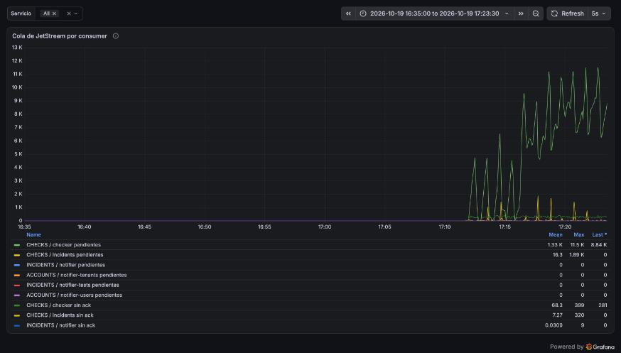
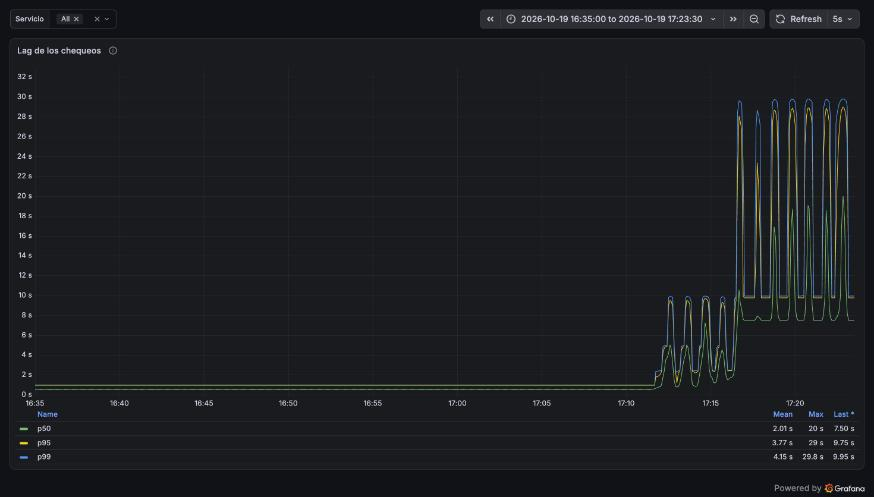

# Reporte de carga: checker-soak (2026-10-19)

| Campo     | Valor                                                                                                        |
| --------- | ------------------------------------------------------------------------------------------------------------ |
| Fecha     | 2026-10-19, 21:36–22:10 UTC (soak) y 22:11–22:24 UTC (sondeo)                                                |
| Commit    | imágenes de `92928be` (sin cambios de código desde entonces); scripts de la rama `test/loadtest-soak`        |
| testid    | soak: `20261019T213651Z-checker-soak`; sondeo: `20261019T221109Z-checker-soak`                               |
| k6        | 2.3.0 en contenedor; no envía carga a Taut, solo lee Prometheus cada 15 s                                    |
| Veredicto | El soak de 2 000 monitores **pasa**; el sondeo de 30 000 encuentra el techo del checker en ~1 000 chequeos/s |

## Resumen

El pipeline de chequeos cumple el SLO con mucho margen. Con 2 000 monitores cada 30 s durante 30
minutos, todos los chequeos empezaron menos de 1 s después de su hora programada, ninguno expiró
y la cola de NATS nunca tuvo un mensaje esperando. Se hicieron exactamente los 120 000 chequeos
esperados, sin fallos, y se guardaron todos. Los servicios casi no se notan: el checker usó un 3 %
de un núcleo, incidents un 2 % y PostgreSQL un 10 %, y la memoria se mantuvo estable.

Un sondeo exploratorio de 10 min con 30 000 monitores (1 000 chequeos/s) encontró el techo. El
checker se queda en ~1,1 núcleos de CPU aunque haya 9 libres, atiende entre 950 y 990 chequeos/s,
y su cola en NATS crece de 6 500 a 15 300 mensajes: el lag p99 llega a 29 s, a un paso de que los
chequeos expiren. La causa está en `taut_bus::consume`: procesa los mensajes con
`for_each_concurrent` dentro de una sola tarea, así que los 100 chequeos concurrentes nunca corren
en paralelo.

## Máquina y configuración

- Igual que la [línea base](2026-10-19-api-crud.md): Apple M4, OrbStack 2.2.4, imágenes release,
  configuración por defecto, a batería con el modo de bajo consumo y con `caffeinate -i`.
- Checker con `TAUT_CHECKS__CONCURRENCY` = 100. El consumer de incidents procesa 32 mensajes a la
  vez. El scheduler relee los monitores cada 30 s.
- Semilla `just loadtest-seed soak`: 200 tenants × 10 monitores HTTP contra el servidor eco,
  cada 30 s, sin historia. Además corrían los 7 monitores de la base de desarrollo, 3 de ellos
  caídos.

## Escenario

`caffeinate -i just loadtest checker-soak`:

- `setup()` espera a que el scheduler tenga los 2 000 monitores (`scheduler_monitors`).
- Calentamiento de 3 min: un intervalo para que los monitores se repartan, y una ventana completa
  para los `rate()`.
- Durante 30 min, k6 consulta Prometheus cada 15 s y guarda cada medida como un `Trend`. Los
  umbrales miran el peor valor de toda la corrida, con ventanas de 2 min.

## Resultados (30 min, 121 lecturas)

| Medida                               | Peor valor | Umbral      | Qué mide                                                      |
| ------------------------------------ | ---------- | ----------- | ------------------------------------------------------------- |
| Chequeos con lag < 10 s              | 100 %      | ≥ 99,5 %    | El SLO: desde la hora programada hasta que el checker empieza |
| p99 del lag                          | 0,99 s     | informativo | Lo domina el tick de 1 s del scheduler                        |
| Chequeos expirados por segundo       | 0          | 0           | Los que nadie tomó antes de su siguiente turno                |
| Programados / esperados (66,7 por s) | 1,001      | ≥ 0,95      | El scheduler publica lo que piden los monitores               |
| Completados / programados            | 0,9999     | ≥ 0,99      | El checker termina lo que recibe                              |
| Guardados / completados              | 0,9985     | ≥ 0,99      | Incidents escribe cada resultado                              |
| Cola del checker en NATS             | 0          | < 667       | Mensajes que todavía no recibió                               |
| Cola de incidents en NATS            | 0          | < 667       | Ídem                                                          |

La proporción de chequeos fallidos (0,13–0,21 %) es informativa. La métrica no distingue tenants,
y la suben los 3 monitores caídos de la base de desarrollo. Los del soak se verificaron por SQL:

| Medida (monitores `lt-k-*`, los 30 min medidos) | Valor                          |
| ----------------------------------------------- | ------------------------------ |
| Chequeos guardados                              | 120 000 (2 000 monitores × 60) |
| Chequeos fallidos                               | 0                              |
| Latencia contra el eco                          | media 6,1 ms, p95 14 ms        |
| Incidentes abiertos                             | 0                              |

## Recursos

| Servicio  | CPU media | CPU máxima | Memoria al inicio | Memoria al final |
| --------- | --------: | ---------: | ----------------: | ---------------: |
| checker   |     3,2 % |      5,7 % |          27,2 MiB |         29,2 MiB |
| incidents |     1,9 % |      3,4 % |           8,8 MiB |         14,3 MiB |
| scheduler |     0,4 % |      0,8 % |           9,9 MiB |          5,1 MiB |
| nats      |     2,6 % |      5,5 % |          63,5 MiB |         65,0 MiB |
| postgres  |     9,9 % |     26,9 % |       2 107,4 MiB |      2 100,2 MiB |

`docker stats` cada 20 s, sin huecos: 90 muestras en 33 min. 100 % equivale a un núcleo.

## Sondeo de 30 000 monitores

`LT_SOAK_TENANTS=3000 just loadtest-seed soak` y
`LT_SOAK_TENANTS=3000 caffeinate -i just loadtest checker-soak -e DURATION=10m`: 3 000 tenants ×
10 monitores, 1 000 chequeos por segundo. Es una sola medición para encontrar el techo, no un
soak; los umbrales que fallan son el resultado.

| Medida                          | Al empezar | Al final (10 min) | Peor valor | Umbral      |
| ------------------------------- | ---------- | ----------------- | ---------- | ----------- |
| Chequeos por segundo (de 1 000) | 1 001      | 977               | 954        | —           |
| Chequeos con lag < 10 s         | 100 %      | 53 %              | 42 %       | ✗ ≥ 99,5 %  |
| p99 del lag                     | 9,7 s      | 29,6 s            | 29,7 s     | informativo |
| Cola del checker en NATS        | 6 539      | 12 925            | 15 344     | ✗ < 10 000  |
| Cola de incidents en NATS       | 1 404      | 659               | 1 890      | ✓           |
| Completados / programados       | —          | —                 | 0,944      | ✗ ≥ 0,99    |
| Chequeos expirados              | 0          | 0                 | 0          | ✓           |

| Servicio  | CPU media | CPU máxima |
| --------- | --------: | ---------: |
| checker   |     110 % |      115 % |
| postgres  |      87 % |      171 % |
| incidents |      23 % |       42 % |
| nats      |      12 % |       40 % |
| scheduler |       2 % |        5 % |

Los contenedores sumaron en promedio 2,5 núcleos de los 10 de la VM. La latencia que mide el
propio checker contra el eco subió de 6 ms a 37 ms (p50) y 210 ms (p95). El eco responde igual
de rápido: lo que crece es la espera de cada chequeo por su turno dentro del checker.

**La causa.** `taut_bus::consume` (`crates/bus/src/lib.rs`) recibe los mensajes y llama al
handler con `StreamExt::for_each_concurrent(concurrency, …)`. Ese combinador intercala hasta
`concurrency` futuros, pero dentro de una sola tarea de tokio, que corre en un hilo a la vez. Con
`TAUT_CHECKS__CONCURRENCY` = 100 hay 100 chequeos en vuelo, pero comparten un núcleo. Por eso el
checker no pasa de ~1,1 núcleos y su techo es ~1 000 chequeos/s, unos 30 000 monitores a 30 s.
Incidents usa la misma función: hoy va holgado (23 %), pero tiene el mismo techo.

## Capturas

Tablero «Taut: servicios», de 16:35 a 17:23 hora local (UTC−5). Hasta las 17:10 corre el soak de
2 000 monitores y desde las 17:11, el sondeo de 30 000. En el soak la cola de NATS está en cero
todo el tiempo. En el sondeo, la del checker (verde) crece hasta 11 500 mensajes y la de
incidents se queda abajo.



El lag de los chequeos es plano, bajo 1 s, durante todo el soak. En el sondeo sube por escalones
hasta que el p99 toca los 30 s, el punto en que los chequeos empezarían a expirar.



## Hallazgos

| Hallazgo                                                                                   | Evidencia                                                                                                                                                    | Propuesta                                                                                                                                                                                                                                                                                      |
| ------------------------------------------------------------------------------------------ | ------------------------------------------------------------------------------------------------------------------------------------------------------------ | ---------------------------------------------------------------------------------------------------------------------------------------------------------------------------------------------------------------------------------------------------------------------------------------------- |
| El stream `CHECKS` crece unos 4,5 GB por día con 2 000 monitores                           | 404 318 mensajes y 159 MB tras el soak (~394 bytes por mensaje); cada chequeo deja 2 mensajes y el stream los guarda 24 h en disco (`crates/bus/src/lib.rs`) | La retención es a propósito: permite reconstruir proyecciones repitiendo los mensajes (CQRS, semana 10). Hay que dimensionar el volumen de NATS en Kubernetes con este número (crece en proporción a los monitores) y ponerle al stream un límite de bytes, para que un pico no llene el disco |
| La métrica de chequeos fallidos no distingue tenants                                       | La proporción de fallos la suben 3 monitores caídos de la base de desarrollo                                                                                 | Aceptable para métricas de plataforma; para alertar por tenant ya está `monitor_status` en la base                                                                                                                                                                                             |
| El checker no pasa de ~1 núcleo: techo de ~1 000 chequeos/s (unos 30 000 monitores a 30 s) | Sondeo de 30 000 monitores: checker a 110–115 % de CPU con la VM al 25 %; cola de NATS creciendo de 6 500 a 15 300                                           | `for_each_concurrent` en `taut_bus::consume` corre todos los handlers en una sola tarea                                                                                                                                                                                                        | Lanzar cada handler con `tokio::spawn` bajo un semáforo de `concurrency` permisos (en su propio PR, midiendo con este sondeo). Para el HPA de la semana 8, escalar el checker por `jetstream_consumer_num_pending{consumer_name="checker"}`, la `uptime_queue_depth` que pide el documento base y ningún servicio emite todavía |

## Cómo reproducir

```sh
just loadtest-up
just loadtest-seed soak
caffeinate -i just loadtest checker-soak
LT_SOAK_TENANTS=3000 just loadtest-seed soak                      # sondeo de 30 000 monitores
LT_SOAK_TENANTS=3000 caffeinate -i just loadtest checker-soak -e DURATION=10m
just loadtest-seed                                                # volver al set base
```
