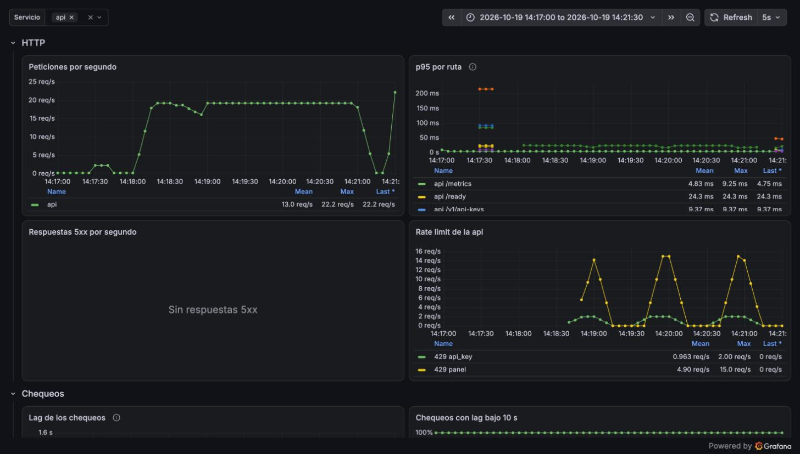

# Reporte de carga: rate-limit (2026-10-19)

| Campo     | Valor                                                                                                     |
| --------- | --------------------------------------------------------------------------------------------------------- |
| Fecha     | 2026-10-19 19:17 UTC                                                                                      |
| Commit    | imágenes de `92928be` (sin cambios de código desde entonces); scripts de la rama `test/loadtest-security` |
| testid    | `20261019T191727Z-rate-limit`                                                                             |
| k6        | 2.3.0 en contenedor, red de compose                                                                       |
| Veredicto | **Pasa** todos los umbrales                                                                               |

## Resumen

El presupuesto por tenant funciona exacto bajo carga. En cada una de las tres ventanas de un
minuto, la api dejó pasar justo 600 peticiones del panel y 60 de la API key, y rechazó el resto
con 429. Los 1 048 rechazos traían un `Retry-After` igual a los segundos que faltaban para el
minuto siguiente. Saturar el panel de un tenant no afectó a su API key ni a otro tenant, y el
limitador no falló abierto ni una vez.

## Máquina y configuración

Igual que la [línea base](2026-10-19-api-crud.md): Apple M4, OrbStack 2.2.4, imágenes release,
configuración por defecto. Redis 7 en compose, sin persistencia.

## Escenario

`just loadtest rate-limit`. En `setup()` hace login de `lt-rl-a` (el tenant inundado) y de
`lt-rl-b` (el control), crea una API key de lectura para `lt-rl-a` y espera hasta un segundo
después del siguiente cambio de minuto. Así la corrida cubre tres ventanas enteras: el limitador
cuenta en ventanas fijas alineadas al minuto (`services/api/src/ratelimit.rs`).

| Escenario | Tenant  | Credencial | Tasa     | Presupuesto | Qué se espera por ventana |
| --------- | ------- | ---------- | -------- | ----------- | ------------------------- |
| `panel`   | lt-rl-a | JWT        | 15 req/s | 600/min     | 600 OK y el resto 429     |
| `apiKey`  | lt-rl-a | API key    | 2 req/s  | 60/min      | 60 OK y el resto 429      |
| `control` | lt-rl-b | JWT        | 2 req/s  | 600/min     | ningún 429                |

Cada petición se asigna a su ventana por la hora en que k6 la envía. k6 y la api comparten el
reloj de la VM, así que solo una petición enviada justo en el borde podría caer en la ventana
vecina. Por eso los umbrales toleran ±2.

## Resultados

| Ventana | Panel OK | API key OK |
| ------: | -------: | ---------: |
|       0 |      600 |         60 |
|       1 |      600 |         60 |
|       2 |      600 |         60 |

| Medida                                                    | Valor                                                                                                                                                |
| --------------------------------------------------------- | ---------------------------------------------------------------------------------------------------------------------------------------------------- |
| Peticiones                                                | 3 393 en 178 s                                                                                                                                       |
| Respuestas 429                                            | 1 048, todas con `error.code = too_many_requests`                                                                                                    |
| `Retry-After` correcto (±1 s)                             | 1 048 de 1 048                                                                                                                                       |
| 429 en el tenant de control                               | 0                                                                                                                                                    |
| Errores del limitador (`api_rate_limit_errors_total`)     | 0                                                                                                                                                    |
| 429 registrados en el servidor (`api_rate_limited_total`) | 851 del panel y 177 de la API key en la ventana de 4 min de Prometheus, que coinciden con los del cliente salvo por la extrapolación de `increase()` |
| Latencia (todas las respuestas)                           | p50 14 ms, p95 19 ms, max 43 ms                                                                                                                      |

## Capturas

Tablero «Taut: servicios» filtrado por la api (hora local, UTC−5). En el panel «Rate limit de la
api», los 429 del panel (amarillo) aparecen a los ~40 s de cada minuto, cuando se agotan las 600
peticiones a 15 por segundo, y caen a cero al empezar la ventana siguiente. Los de la API key
(verde) empiezan a los 30 s, cuando se agotan las 60. Ninguna respuesta 5xx.



## Observaciones

- **Las peticiones rechazadas antes del limitador no gastan presupuesto.** `CurrentTenant`
  (`services/api/src/tenant.rs`) descuenta del presupuesto solo después de comprobar la
  membresía. Un usuario que manda un `X-Tenant-Id` ajeno recibe 403 y no gasta ni su presupuesto
  ni el del otro tenant: nadie puede agotar el presupuesto de un tenant al que no pertenece. La
  contracara es que esos 403 no tienen límite propio. Cada uno cuesta una consulta de membresía,
  así que conviene limitarlos por usuario si se vuelven un vector de abuso.
- **Variante `HOT_TENANT` de api-crud descartada.** Iba a medir el bloqueo `FOR UPDATE` al crear
  monitores en un solo tenant. Pero el presupuesto de 600/min limita las escrituras de un tenant
  a unas 2 creaciones por segundo, y a esa tasa el bloqueo, que dura milisegundos, no puede
  formar cola. El propio rate limit impide que ese bloqueo sea un problema en el plan free.

## Cómo reproducir

```sh
just loadtest-up
just loadtest-seed
just loadtest smoke
just loadtest rate-limit
```
