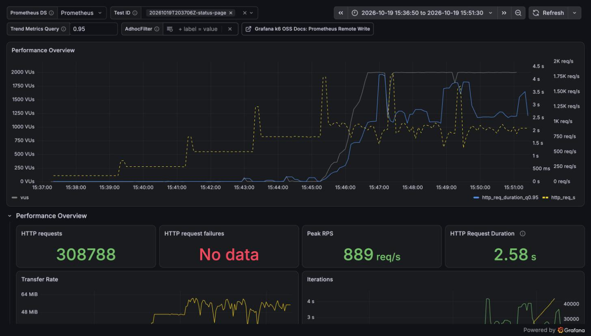
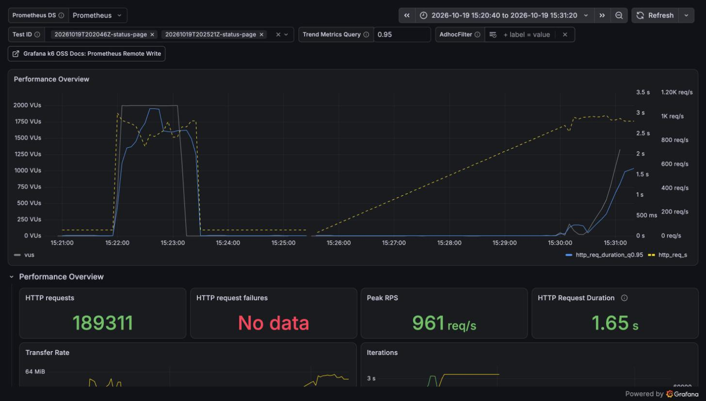

# Reporte de carga: límites de la página de estado (2026-10-19)

| Campo     | Valor                                                                                                                                                                  |
| --------- | ---------------------------------------------------------------------------------------------------------------------------------------------------------------------- |
| Fecha     | 2026-10-19, 20:20–20:56 UTC                                                                                                                                            |
| Commit    | imágenes de `92928be` (sin cambios de código desde entonces); scripts de la rama `test/loadtest-security`                                                              |
| testid    | stress: `20261019T203706Z-status-page`; spike: `20261019T202046Z-status-page`; breakpoint: `20261019T202521Z-status-page`; diagnóstico: `20261019T205512Z-status-page` |
| k6        | 2.3.0 en contenedor, red de compose, hasta 2 000 VUs                                                                                                                   |
| Veredicto | El SLO se cumple hasta unas 750–900 req/s y el techo queda cerca de 920 req/s; tras un pico se recupera en segundos y sin errores                                      |

## Resumen

En escalones de 2 min, la página cumple el SLO hasta 750 req/s (p95 58 ms). A 1 000 req/s ofrecidas
lo pierde: solo atiende 923 req/s, con 2,5 s de p95. Por encima de eso rinde menos, no más (858 y
840 req/s). El breakpoint, con una rampa continua, ubica el mismo codo: el p95 sigue bajo 10 ms
hasta ~820 req/s y supera el segundo pasadas las 1 000. En un pico de 2 000 req/s la página atiende
~850 req/s sin un solo error, y vuelve a 8,5 ms en menos de 10 s cuando la carga baja.

Lo que pone el techo sigue abierto. Ni la CPU del Mac (quedó un 35–40 % libre) ni el pool de
conexiones de status-bff (casi siempre tenía conexiones libres) se agotan. Además, todas las
corridas se hicieron a batería y con el modo de bajo consumo de macOS activo. Antes de comparar
con la caché en la semana 13 hay que perfilar status-bff y repetir la línea base conectado a la
corriente.

## Máquina y configuración

- Igual que la [línea base](2026-10-19-status-page.md): Apple M4 (4 núcleos de rendimiento y 6
  de eficiencia), OrbStack 2.2.4, imágenes release, configuración por defecto y sin caché.
- **A batería y en modo de bajo consumo.** `pmset -g custom` muestra `lowpowermode 1` para la
  batería, y el equipo estuvo a batería todo el día (del 99 % al 59 %). Las corridas son
  comparables entre sí, pero los números absolutos quedan por debajo de los que daría conectado.
- **Un stress descartado.** El primer intento de stress (`20261019T192506Z`) quedó invalidado
  porque el Mac entró en reposo a los 5 minutos y congeló los contenedores. El que se reporta
  aquí se repitió con `caffeinate -i` y tiene las 83 muestras de CPU, sin huecos.

## Stress

`caffeinate -i just loadtest status-page -e PROFILE=stress`: siete escalones de 2 min sin rampa
entre ellos.

|     Escalón | Tasa lograda |      p50 |      p95 |      p99 | Errores | CPU pico: status-bff / PostgreSQL / k6 |
| ----------: | -----------: | -------: | -------: | -------: | ------: | -------------------------------------- |
|   100 req/s |    100 req/s |   4,2 ms |   6,3 ms |   6,8 ms |       0 | 17 % / 38 % / 7 %                      |
|   250 req/s |    250 req/s |   3,1 ms |   5,4 ms |  11,4 ms |       0 | 65 % / 140 % / 19 %                    |
|   500 req/s |    500 req/s |   3,5 ms |   6,9 ms |  24,6 ms |       0 | 86 % / 157 % / 24 %                    |
|   750 req/s |    750 req/s |   4,3 ms |    58 ms |   192 ms |       0 | 184 % / 250 % / 36 %                   |
| 1 000 req/s |    923 req/s | 1 325 ms | 2 491 ms | 3 957 ms |       0 | 299 % / 317 % / 91 %                   |
| 1 250 req/s |    858 req/s | 2 170 ms | 3 095 ms | 3 767 ms |       0 | 256 % / 331 % / 210 %                  |
| 1 500 req/s |    840 req/s | 2 295 ms | 3 069 ms | 3 763 ms |       0 | 216 % / 276 % / 140 %                  |

- 0 errores en 506 311 peticiones. La respuesta más lenta tardó 4,4 s, por debajo del timeout de
  30 s.
- Desde 1 000 req/s, k6 usó sus 2 000 VUs y descartó 135 715 iteraciones: con ~2,5 s por
  respuesta no puede ofrecer más.
- Pasado el techo, la tasa lograda baja en vez de mantenerse. Parte se explica porque k6, con
  2 000 VUs, también consume más CPU de la misma máquina (hasta 2,1 núcleos).

## Spike

`just loadtest status-page -e PROFILE=spike`: 1 min a 50 req/s, subida a 2 000 req/s en 10 s,
1 min sostenido, bajada a 50 en 10 s y 2 min más a 50 req/s.

| Fase               | Tasa lograda  | p95       | Errores |
| ------------------ | ------------- | --------- | ------: |
| Antes (50 req/s)   | 50 req/s      | 8,7 ms    |       0 |
| Pico (2 000 req/s) | 790–960 req/s | 2,0–2,8 s |       0 |
| Después (50 req/s) | 50 req/s      | 8,6 ms    |       0 |

- **Recuperación:** 10 s después de que la carga vuelve a 50 req/s, el p95 ya es de 8,5 ms. No
  quedan colas ni conexiones colgadas: la página se recupera sola.
- **Errores:** 0 de 77 973 peticiones, sin 5xx ni 408.
- **Lo que no llegó:** k6 alcanzó su tope de 2 000 VUs y descartó 71 547 iteraciones, así que el
  servidor recibió menos carga de la ofrecida. Sin ese tope la cola habría crecido más.
- **Servidor en el pico:** status-bff a 354 % de CPU, PostgreSQL a 349 % y k6 a 121 %.

## Breakpoint

`just loadtest status-page -e PROFILE=breakpoint`: rampa continua de 0 a 3 000 req/s en 15 min.
La corrida se corta sola cuando el p95 acumulado pasa de 1 s o los errores del 5 %.

|  Tiempo | Tasa ofrecida (aprox.) | Tasa lograda |      p95 | VUs en uso | Descartadas/s |
| ------: | ---------------------: | -----------: | -------: | ---------: | ------------: |
| 2,7 min |                    530 |          516 |   5,2 ms |          2 |             0 |
| 3,7 min |                    730 |          716 |   5,7 ms |          3 |             0 |
| 4,2 min |                    830 |          816 |   6,2 ms |          5 |             0 |
| 4,7 min |                    930 |          916 |    63 ms |         11 |             0 |
| 5,2 min |                  1 030 |          997 |   197 ms |        195 |             0 |
| 5,7 min |                  1 130 |          977 | 1 286 ms |      1 328 |            83 |

- **Corte:** a los 5,7 min (~1 140 req/s ofrecidas), por un p95 acumulado de 1,03 s. 0 errores en
  193 228 peticiones.
- **Techo:** en esta corrida, ~1 000 req/s. A partir de ahí cada petición de más solo alarga la
  cola, y los VUs en uso suben de 195 a 1 328 en medio minuto (ley de Little).

## Qué pone el techo

Al terminar se hizo un diagnóstico de 90 s a 1 200 req/s (`-e RATE=1200`), con dos mediciones:

- **Pool de status-bff:** se muestreó `pg_stat_activity` cada 2 s para las 10 conexiones de
  status-bff. En casi todas las muestras había entre 2 y 6 conexiones libres (`idle`). El resto
  estaba `active` o `idle in transaction`, es decir, retenida por una tarea que espera turno entre
  dos consultas. Las peticiones no esperan por una conexión libre.
- **CPU del Mac:** `top` en el host, con la misma carga, dio entre 33 % y 42 % de CPU libre.

La CPU total y el pool quedan descartados como límite. status-bff es el proceso más ocupado (3 a
4,5 núcleos) y no usa más aunque haya CPU libre, lo que apunta a algo dentro del proceso que
serializa el trabajo. Dos candidatos a revisar con un perfilador: el log JSON de cada petición
escrito a stdout, y el armado y la serialización de la página de 66 KB. En esa corrida la página
atendió 728–795 req/s, menos que horas antes con más batería; el modo de bajo consumo hace que los
números absolutos varíen.

## Lo que no se ve afectado

En el pico y en el corte, los chequeos de fondo (unos 5 por segundo) mantuvieron un lag p95 de
0,96 s y ninguno expiró. Saturar la página de estado no frena el monitoreo, porque el checker y el
scheduler no comparten proceso ni pool con status-bff.

## Capturas

Stress en el tablero de k6 (hora local). Los escalones hasta 750 req/s mantienen la latencia
pegada a cero. En el de 1 000 req/s los VUs suben a 2 000 y el p95 pasa de 2 s.



Spike (izquierda) y breakpoint (derecha). El pico satura la página y, en cuanto la carga baja, el
p95 vuelve a cero. La rampa del breakpoint sube sin problemas hasta ~950 req/s y se corta sola
cuando la latencia se dispara.



## Cuellos de botella

| Síntoma                                                   | Evidencia                                                                                                | Hipótesis                                                                                                | Arreglo propuesto                                                                                                                 |
| --------------------------------------------------------- | -------------------------------------------------------------------------------------------------------- | -------------------------------------------------------------------------------------------------------- | --------------------------------------------------------------------------------------------------------------------------------- |
| Techo de ~920 req/s y SLO perdido entre 750 y 1 000 req/s | Stress y breakpoint; status-bff a 3–4,5 núcleos, con CPU libre en el host y conexiones libres en el pool | Algo dentro de status-bff serializa el trabajo, como el log por petición o la serialización de la página | Perfilar status-bff antes de la semana 13; la caché de Redis (`status:{slug}`, 30 s) evitaría el armado de la página en todo caso |
| Medición a batería en modo de bajo consumo                | `lowpowermode 1` a batería; todas las corridas del 19-10                                                 | Limita la CPU y hace variar los números absolutos                                                        | Repetir la línea base y la corrida con caché conectado a la corriente, para que la semana 13 compare lo mismo                     |
| Rinde menos al sobrecargarse                              | 923, 858 y 840 req/s en los últimos tres escalones                                                       | k6, con 2 000 VUs, compite por la CPU de la misma máquina                                                | Medir contra staging con k6 en otra máquina                                                                                       |

## Cómo reproducir

```sh
just loadtest-up
just loadtest-seed
just loadtest smoke
caffeinate -i just loadtest status-page -e PROFILE=stress   # macOS: que no entre en reposo
just loadtest status-page -e PROFILE=spike
just loadtest status-page -e PROFILE=breakpoint
```
