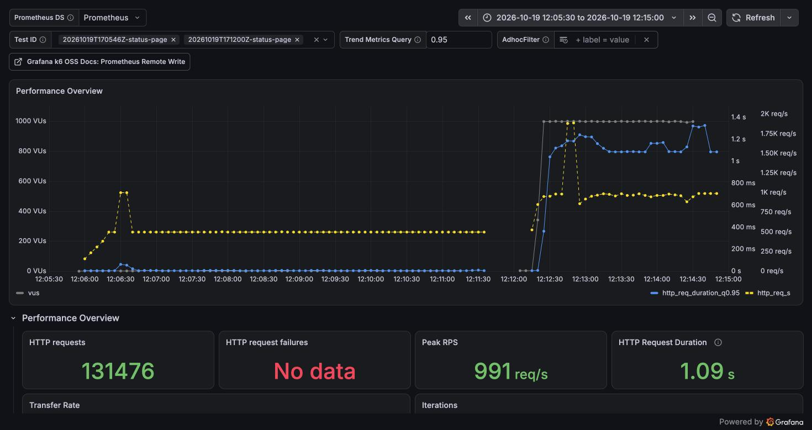
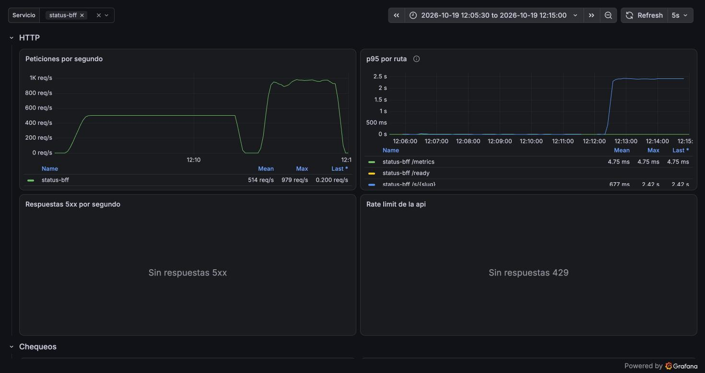
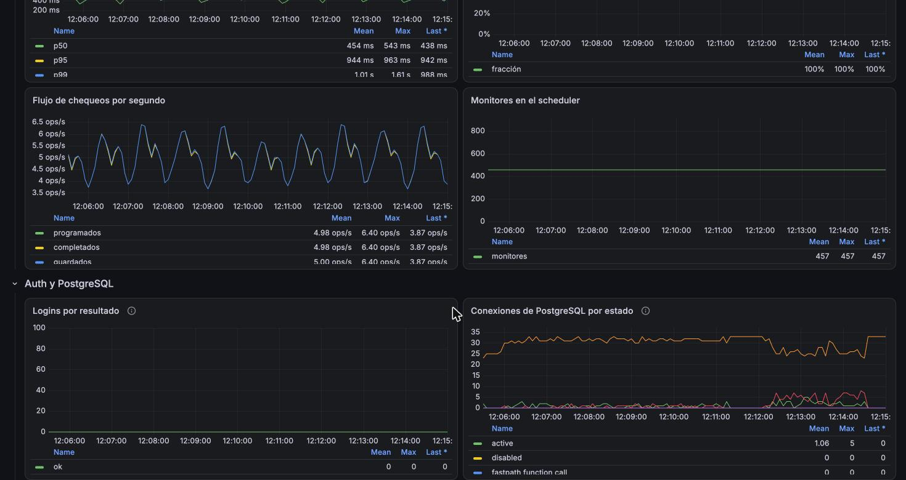

# Reporte de carga: status-page (2026-10-19)

| Campo     | Valor                                                                   |
| --------- | ----------------------------------------------------------------------- |
| Fecha     | 2026-10-19 17:05 UTC                                                    |
| Commit    | `92928be` (rama `test/loadtest-base`), imágenes release                 |
| testid    | `20261019T170546Z-status-page` (sondeo: `20261019T171200Z-status-page`) |
| k6        | 2.3.0 en contenedor, red de compose                                     |
| Veredicto | **Pasa** todos los umbrales a 500 req/s                                 |

## Resumen

Es la línea base sin caché de la semana 6. Las 20 páginas de estado, con 10 monitores y 90 días
cada una, responden 500 req/s con un p95 de 6 ms, sin errores. Un sondeo exploratorio a
2 000 req/s encontró el techo en unas 950 req/s. Ahí el límite es la CPU de status-bff
(4,6 núcleos), no PostgreSQL ni el pool, y la latencia sube a ~1 s sin errores. La comparación
con Redis de la semana 13 debería hacerse a 500 req/s (no cambia nada) y también cerca del techo,
a 900 req/s, donde la caché sí debería notarse.

## Máquina

| Campo          | Valor                                                   |
| -------------- | ------------------------------------------------------- |
| Equipo         | Apple M4, 10 núcleos, 16 GB                             |
| SO             | macOS 27.0.1                                            |
| Docker         | OrbStack 2.2.4 (Docker 29.8.2), VM con 10 CPU y 7,8 GiB |
| Dónde corre k6 | contenedor `grafana/k6:2.3.0` en la misma VM que Taut   |

## Configuración

- Imágenes release de `92928be`, con la configuración por defecto: pool de 10 conexiones, logs
  `info` y sin caché de Redis. El `Cache-Control: max-age=30` no aplica, porque k6 no cachea.
- Semilla por defecto: los 20 tenants `lt-s-*` tienen 10 monitores cada uno, con 89 días de
  historia a 5 min y un incidente resuelto en la última semana por monitor. `uptime_daily` se
  materializó al sembrar.
- Carga de fondo: los 450 monitores sembrados se chequean contra el eco (unos 5 por segundo).

## Escenario

`just loadtest status-page` con los valores por defecto:

- `ramp`: de 50 a 500 req/s en 30 s, fuera de los umbrales.
- `steady`: 500 req/s durante 5 min (modelo abierto).
- Cada petición va a una de las 20 páginas, en rueda (`SLUGS=spread`).
- Una de cada 100 respuestas se parsea y se comprueba que trae los 10 monitores con 90 días.
- Umbrales: p95 < 300 ms, p99 < 1 s, errores < 1 %, cero iteraciones descartadas.

## Resultados (fase estable, 300 s)

| Ruta           | req/s |    p50 |    p90 |    p95 |     p99 |    max |
| -------------- | ----: | -----: | -----: | -----: | ------: | -----: |
| `GET /s/:slug` | 500,0 | 3,4 ms | 5,1 ms | 6,0 ms | 12,4 ms | 173 ms |

- Errores: 0 de 150 001 peticiones. Iteraciones descartadas: 0.
- VUs: como máximo 31 en uso, de 300 reservados.
- Respuesta: unos 66 KB de JSON sin comprimir por página, 31 MB/s en total.

## Lado servidor

| Medida                             | Valor          | Fuente                          |
| ---------------------------------- | -------------- | ------------------------------- |
| p95 en el servidor, `/s/{slug}`    | 6,8 ms         | `http_request_duration_seconds` |
| Conexiones de PostgreSQL (pico)    | 33, 3 activas  | `pg_stat_activity_count`        |
| CPU de PostgreSQL (pico)           | 116 %, 2,1 GiB | `docker stats`                  |
| CPU de status-bff (pico)           | 65 %, 22 MiB   | `docker stats`                  |
| CPU de k6 (pico)                   | 25 %           | `docker stats`                  |
| Lag de los chequeos de fondo (p95) | 0,95 s         | `uptime_check_lag_seconds`      |

## Sondeo exploratorio a 2 000 req/s

`just loadtest status-page -e RATE=2000 -e DURATION=2m`. No es el perfil de stress de la fase 2:
es una sola medición, para saber dónde está el techo.

| Medida                      | Valor                                                      |
| --------------------------- | ---------------------------------------------------------- |
| Tasa lograda (fase estable) | 951 req/s de las 2 000 ofrecidas                           |
| Latencia                    | p50 1,04 s, p95 1,16 s, p99 1,23 s                         |
| Errores                     | 0 de 114 093                                               |
| Iteraciones descartadas     | 133 364 (k6 llegó a sus 1 000 VUs)                         |
| CPU de status-bff (pico)    | 457 % (4,6 núcleos)                                        |
| CPU de PostgreSQL (pico)    | 255 %                                                      |
| CPU de k6 (pico)            | 115 %                                                      |
| PostgreSQL                  | 5 conexiones activas y 8 «idle in transaction» como máximo |

Con 1 000 VUs y ~1 s por respuesta, la ley de Little da ~1 000 req/s: k6 no pudo ofrecer más
porque cada VU esperaba su respuesta. Por eso el umbral que falla es `dropped_iterations`, no el
de errores.

## Capturas

Tablero de k6 con la línea base (izquierda, 500 req/s y p95 pegado a cero) y el sondeo
(derecha). En el sondeo, k6 llega a sus 1 000 VUs, logra ~950 req/s y la latencia sube a ~1 s.
Los paneles de resumen corresponden al sondeo; «HTTP request failures» sale vacío porque no hubo
ningún fallo.



Lado servidor de status-bff. El p95 de `/s/{slug}` medido en el servidor sube a 2,4 s durante el
sondeo, porque incluye la espera en la cola del runtime. No hubo respuestas 5xx.



Conexiones de PostgreSQL y chequeos de fondo. Las «idle in transaction» (rojo) solo aparecen en
el sondeo. Los chequeos siguen a ~5 por segundo, todos con lag bajo 10 s.



## Cuellos de botella

| Síntoma                                                     | Evidencia                                                                                     | Hipótesis                                                                                                                                                                                                                                                                                                                                                     | Arreglo propuesto                                                                                                               |
| ----------------------------------------------------------- | --------------------------------------------------------------------------------------------- | ------------------------------------------------------------------------------------------------------------------------------------------------------------------------------------------------------------------------------------------------------------------------------------------------------------------------------------------------------------- | ------------------------------------------------------------------------------------------------------------------------------- |
| Techo de ~950 req/s, con la latencia pasando de 6 ms a ~1 s | status-bff a 4,6 núcleos frente a 2,5 de PostgreSQL; hasta 8 conexiones «idle in transaction» | Cada petición hace 4 consultas en una transacción, decodifica ~900 filas de `uptime_daily`, arma 10 × 90 barras y serializa ~66 KB de JSON (`services/status-bff/src/lib.rs`). La CPU por página es el límite. Con la CPU saturada, cada tarea espera turno entre consulta y consulta, y mientras tanto retiene su conexión: de ahí las «idle in transaction» | La caché de Redis de la semana 13 (clave `status:{slug}`, 30 s) evita casi todo ese trabajo. Medir otra vez a 500 y a 900 req/s |
| 66 KB por respuesta sin comprimir                           | `data_received` de 10 GB en 5 min                                                             | No hay capa de compresión (`crates/http/src/layers.rs`)                                                                                                                                                                                                                                                                                                       | gzip/br en la capa HTTP o en el ingress; el JSON de barras comprime muy bien                                                    |

## Comparación

Es la primera corrida: es la línea base sin caché.

## Cómo reproducir

```sh
git checkout 92928be   # o el commit que fusione este PR
just loadtest-up
just loadtest-seed
just loadtest smoke
just loadtest status-page
just loadtest status-page -e RATE=2000 -e DURATION=2m   # sondeo
```
