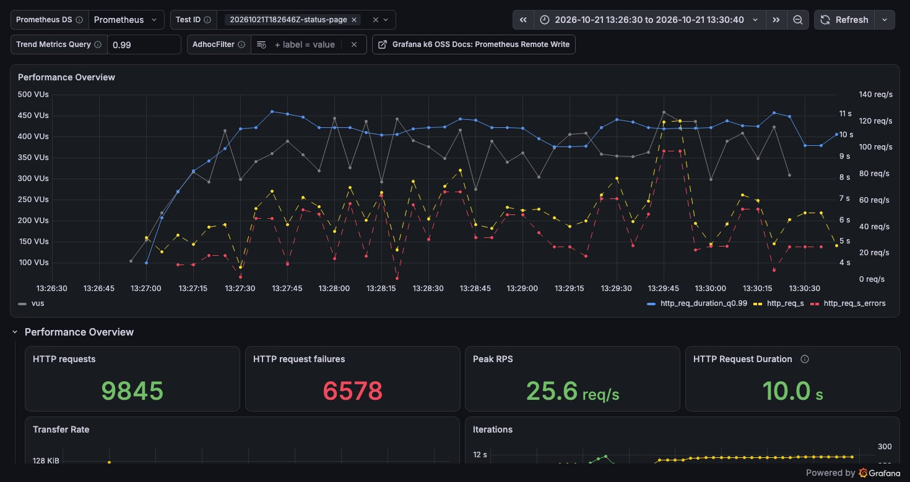
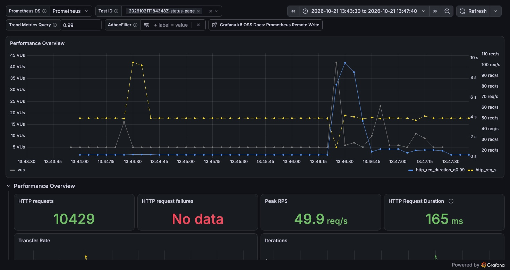
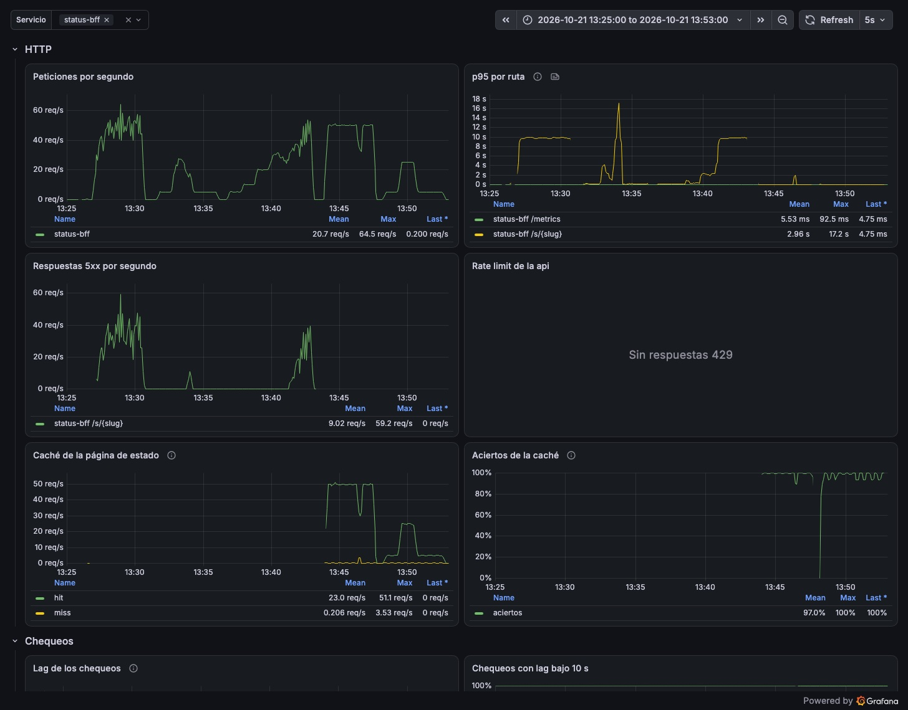
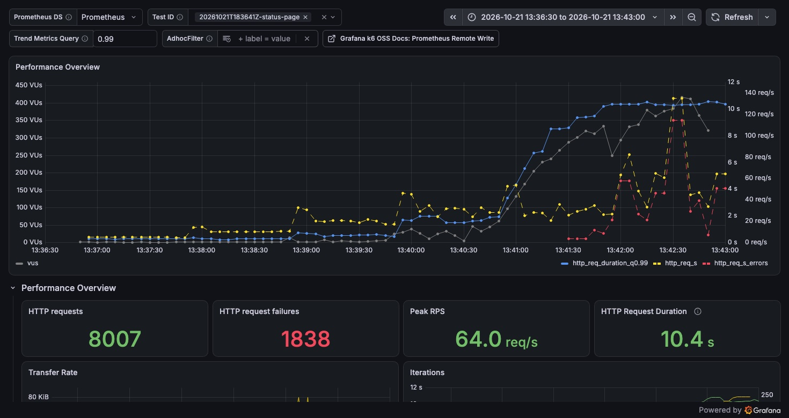
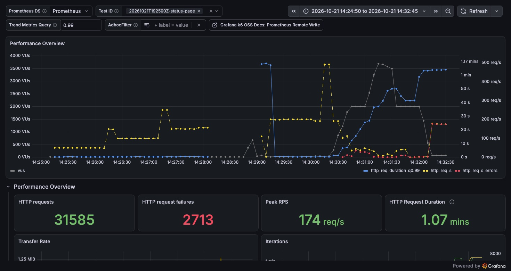
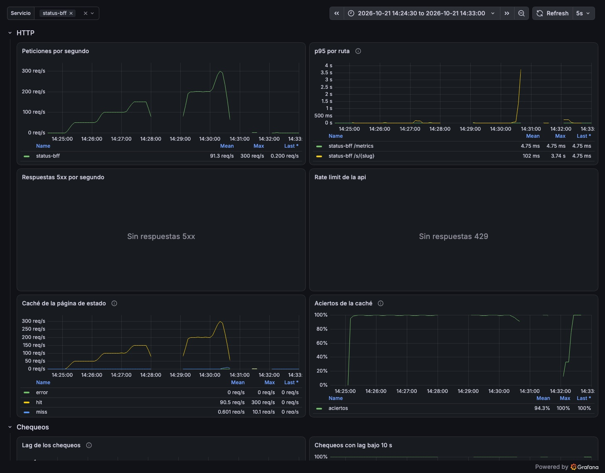

# Reporte de carga: página de estado con y sin caché en la VPS (2026-10-21)

| Campo     | Valor                                                                                        |
| --------- | -------------------------------------------------------------------------------------------- |
| Fecha     | 2026-10-21, 18:26–19:34 UTC                                                                  |
| Commit    | `31bbaf3` (`feat/status-page-cache`), imagen `ghcr.io/frknk/taut-status-bff:sha-31bbaf3`     |
| testid    | ver la tabla de corridas                                                                     |
| k6        | 2.3.0 en contenedor en el Mac, contra https://taut.lat por internet (~90 ms de ida y vuelta) |
| Veredicto | **Pasa con caché**: 50 req/s sin errores y p95 de 249 ms; sin caché, 70 % de errores         |

## Resumen

status-bff guarda ahora cada página de estado 30 s en Redis, ya serializada y comprimida con
brotli. Se midió en la VPS de la demo con la misma imagen, apagando la caché
(`TAUT_STATUS__CACHE_TTL_SECS=0`) y prendiéndola, el mismo día y con las mismas pruebas del
20-10. Sin caché la VPS cumple el SLO solo hasta 10 req/s y a 50 req/s falla el 70 % de las
peticiones porque status-bff se queda sin conexiones a PostgreSQL. Con caché, a 50 req/s no hay
errores, el servidor arma la respuesta en 5 ms (p95) en vez de 9,8 s, y casi todo lo que ve el
cliente es la red: la mediana es de 93 ms. El techo con caché está en 200 req/s; a 300 req/s suben
a la vez los fallos de caché y los timeouts de Caddy hacia status-bff, y no está claro cuál de los
dos arrastra al otro.

## Entorno

| Campo         | Valor                                                                                               |
| ------------- | --------------------------------------------------------------------------------------------------- |
| Servidor      | VPS de Oracle Cloud: 1/8 de OCPU AMD EPYC 7551 (2 vCPU visibles), 954 MB de RAM y 2 GB de swap      |
| Despliegue    | Docker compose con las imágenes de GHCR (`:main`) y status-bff en `sha-31bbaf3`; Caddy con TLS      |
| Configuración | Pool de 4 conexiones por servicio, límite de memoria por contenedor, logs `info`                    |
| Redis         | Redis 7 sin persistencia, `maxmemory` 32 MB con `volatile-lru`; una página ocupa 865 bytes          |
| Datos         | 5 páginas de estado (`lt-s-01`…`05`) con 5 monitores y 30 días de historia                          |
| Cliente       | k6 en el Mac (`loadtest/vps-demo.sh`), Prometheus y Grafana locales leyendo la VPS por un túnel SSH |

- **Una sola imagen de status-bff para todas las corridas.** Solo cambia
  `TAUT_STATUS__CACHE_TTL_SECS` (0 o 30), con `loadtest/vps-demo.sh cache 0|30`, que recrea el
  contenedor.
- Primero las tres pruebas sin caché, después las mismas con caché y al final los escalones altos,
  con 30 s de recuperación medida entre corrida y corrida.
- CPU y memoria por contenedor con `docker stats` cada ~3 s. En esta VPS el tiempo robado por el
  hipervisor es alto y los porcentajes no son absolutos: sirven para comparar entre corridas.

## Corridas

| Prueba                | Sin caché                      | Con caché                      |
| --------------------- | ------------------------------ | ------------------------------ |
| Carga sostenida       | `20261021T182646Z-status-page` | `20261021T184348Z-status-page` |
| Pico                  | `20261021T183132Z-status-page` | `20261021T184808Z-status-page` |
| Escalones de 5 a 50   | `20261021T183641Z-status-page` | `20261021T191745Z-status-page` |
| Escalones de 50 a 400 | —                              | `20261021T192500Z-status-page` |

Los resúmenes están en `docs/loadtest/data/<testid>.json`.

## Resultados

Carga sostenida: 30 s de rampa y 3 min a 50 req/s sobre las 5 páginas.

| Medida (fase estable)   |      Sin caché | Con caché |
| ----------------------- | -------------: | --------: |
| Respuestas 200          |          2 574 |     9 001 |
| Errores (500)           | 6 135 (70,4 %) |         0 |
| Iteraciones descartadas |            547 |         0 |
| p50                     |         8,27 s |     94 ms |
| p95                     |        10,04 s |    249 ms |
| p99                     |        10,32 s |    669 ms |
| VUs de k6 (máximo)      |            847 |       300 |

Pico: 1 min a 5 req/s, 1 min a 25 req/s (con 10 s de subida y de bajada) y 2 min a 5 req/s.

| Fase              | Sin caché                                            | Con caché                        |
| ----------------- | ---------------------------------------------------- | -------------------------------- |
| Antes (5 req/s)   | p95 239 ms, 0 errores                                | p95 98 ms, 0 errores             |
| Pico (25 req/s)   | p50 1,23 s, p95 8,89 s, 166 errores de 1 799 (9,2 %) | p50 94 ms, p95 156 ms, 0 errores |
| Después (5 req/s) | p95 259 ms, p99 4,45 s, 0 errores                    | p95 102 ms, 0 errores            |

Escalones de 1 min:

| Escalón  | Sin caché: p95 | Sin caché: errores | Con caché: p95 | Con caché: errores |
| -------- | -------------: | -----------------: | -------------: | -----------------: |
| 5 req/s  |         193 ms |                  0 |         102 ms |                  0 |
| 10 req/s |         195 ms |                  0 |         114 ms |                  0 |
| 20 req/s |     **535 ms** |                  0 |         130 ms |                  0 |
| 30 req/s |     **1,61 s** |                  0 |         149 ms |                  0 |
| 40 req/s |     **9,56 s** |         **19,8 %** |         169 ms |                  0 |
| 50 req/s |     **9,95 s** |         **62,6 %** |         160 ms |                  0 |

En negrita lo que no cumple el SLO (p95 < 300 ms, errores < 1 %).

Escalones altos con caché, de 1 min (`RATES=50,100,150,200,300,400`):

| Escalón   |                      p95 |    p99 |            Errores | Atendidas por status-bff |
| --------- | -----------------------: | -----: | -----------------: | -----------------------: |
| 50 req/s  |                   161 ms | 181 ms |                  0 |                ~50 req/s |
| 100 req/s |                   167 ms | 283 ms |                  0 |               ~100 req/s |
| 150 req/s |                 3,37 s ¹ | 63 s ¹ |                  0 |               ~150 req/s |
| 200 req/s |                   297 ms | 773 ms |                  0 |               ~200 req/s |
| 300 req/s |               **23,1 s** | 37,7 s |    **707 (7,7 %)** |               ~250 req/s |
| 400 req/s | **60 s** (timeout de k6) |      — | **2 006 (99,4 %)** |                1–2 req/s |

¹ Un corte de cerca de un minuto en el que se perdieron las métricas del túnel y las de k6; las
peticiones de ese escalón esperaron hasta 84 s y terminaron bien. No se sabe si fue la conexión
entre el Mac y la VPS o la red del propio Mac. El escalón de 200 req/s cumple el SLO.

- A 300 y 400 req/s k6 llegó a los 2 000 VUs por escalón y descartó 29 895 iteraciones.
- Cerca de las 19:30:30, ya en los escalones de 300 y 400 req/s, status-bff atendía ~260 req/s con
  un p95 de 5 a 7 ms. En los 20 s siguientes los fallos de caché subieron de 0,7 a ~6 por segundo
  y el p95 del servidor llegó a 3,7 s; desde ahí casi no le llegaron peticiones.
- En esos dos escalones Caddy registró 553 `dial tcp: lookup status-bff: i/o timeout` y 232
  `dial tcp 172.20.0.9:8080: i/o timeout`: no llegaba a resolver ni a conectar con status-bff
  dentro de la red de Docker. Antes de las 19:30 no hay ninguno.
- No hay datos de CPU de los escalones de 200 a 400 req/s: el muestreo con `docker stats` se
  cortó a las 19:27:46 con el corte de red. Hasta ahí, la carga de la VPS no pasó de 0,39 y los
  picos fueron de 46 % en PostgreSQL, 73 % en status-bff y 47 % en Caddy.

## Lado servidor

| Medida                                      | Sin caché | Con caché                                                                                | Fuente                                    |
| ------------------------------------------- | --------- | ---------------------------------------------------------------------------------------- | ----------------------------------------- |
| p95 de `/s/{slug}` en status-bff a 50 req/s | 9,84 s    | 5,0 ms                                                                                   | `http_request_duration_seconds`           |
| p95 de `/s/{slug}` en status-bff a 10 req/s | 99 ms     | —                                                                                        | ídem                                      |
| p95 de `/s/{slug}` en status-bff a 30 req/s | 2,25 s    | —                                                                                        | ídem                                      |
| Aciertos de la caché (sostenida)            | —         | 99,1 % (8 679 aciertos, 76 fallos)                                                       | `status_page_cache_total`                 |
| CPU de PostgreSQL, promedio (sostenida)     | ~400 %    | ~8 %                                                                                     | `docker stats`                            |
| CPU de status-bff, promedio (sostenida)     | ~95 %     | ~4 %                                                                                     | `docker stats`                            |
| Memoria de Caddy, pico (límite 128 MB)      | 112 MB    | 112 MB en la sostenida (justo después de las corridas sin caché), 49 MB en los escalones | `docker stats`                            |
| Errores de Redis                            | —         | 0                                                                                        | `status_page_cache_total{result="error"}` |

- Sin caché, cada uno de los 6 135 errores es `pool timed out while waiting for an open connection`
  en status-bff, como el 20-10: con 4 conexiones y páginas que tardan más en PostgreSQL a medida
  que sube la carga, las peticiones esperan una conexión hasta que se rinden.
- Con caché, la diferencia entre los 94 ms de mediana que ve k6 y los 5 ms del servidor es la red
  entre el Mac y la VPS y el TLS de Caddy.

## Capturas

Tableros de Grafana en hora del Mac (UTC−5).

Carga sostenida sin caché en k6: el p99 (azul) sube a unos 10 s en el primer minuto y los errores
(rojo) acompañan a la tasa de peticiones (amarillo) hasta el final.



Carga sostenida con caché en k6: 50 req/s sin errores y el p99 bajo medio segundo, salvo unos
15 s en los que llegó a 10 s, cuando en el servidor hubo una ráfaga de fallos de caché.



status-bff en el servidor, desde la carga sostenida sin caché hasta el pico con caché. Sin caché el
p95 de la página llega a 10 s y hay hasta 60 respuestas 5xx por segundo; con caché (desde las
13:44) el p95 baja a milisegundos, no hay 5xx y casi todas las páginas salen de Redis.



Escalones sin caché en k6: hasta 20 req/s el p99 queda bajo un segundo; en el de 30 pasa a unos
2 s y desde el de 40 sube a 10 s con errores.



Escalones altos con caché en k6: la latencia es baja en los primeros escalones; el hueco de un
minuto y el p99 de más de un minuto que le sigue son el corte del escalón de 150 req/s; al final,
en los de 300 y 400 req/s, se disparan los VUs, la latencia y los errores.



status-bff en el servidor durante los escalones altos: atiende hasta 300 req/s, casi todo desde
la caché y sin respuestas 5xx. El hueco es el mismo corte. Cerca de las 14:30:40 suben los fallos
de caché y el p95 llega a 3,7 s; después casi no le llegan peticiones.



## Qué se encontró

- **La caché saca a PostgreSQL del camino.** Con 5 páginas y 30 s de vida, a 50 req/s se arma
  una página unas 25 veces por minuto en vez de 3 000. El techo de la VPS deja de ser el pool de
  conexiones: a 200 req/s, cuatro veces la tasa que tumbaba la VPS sin caché, cumple el SLO.
- **Sobre 200 req/s no está claro qué cede primero.** Cerca de las 19:30:30, en el mismo medio minuto, los
  fallos de caché subieron a ~6 por segundo, el p95 de status-bff pasó de 7 ms a 3,7 s y Caddy
  dejó de poder resolver `status-bff` en el DNS de Docker y de conectarse a él. Hay dos
  explicaciones posibles, sin confirmar: que cada conexión nueva de Caddy pase por el DNS de
  Docker y esa ruta se sature, o que las páginas que vencen se reconstruyan muchas veces a la vez
  (contra un pool de 4 conexiones, y comprimiendo con brotli dentro del executor de tokio) y
  status-bff deje de aceptar conexiones. Para separarlas: una sola reconstrucción por página y
  k6 corriendo cerca de la VPS.
- **La VPS estaba más lenta que el 20-10.** Sin caché, la misma prueba sostenida dio 70 % de
  errores (28,5 % el 20-10) y el pico 166 errores (ninguno el 20-10). Por eso la comparación se
  hizo con la misma imagen y el mismo día, cambiando solo la variable.
- **Varias peticiones arman la misma página cuando vence.** Fueron 76 fallos en 3 min, cuando
  bastarían 30 (5 páginas, una vez cada 30 s): las peticiones que llegan mientras se reconstruye
  una página también van a la base. Si el servidor se frena justo en ese momento, se acumulan: a
  las 18:46:25, en la carga sostenida con caché, hubo unos 25 fallos en 5 s, el p95 de status-bff
  llegó a 2,5 s y k6 vio su máximo de 9,8 s.
- **El agotamiento del pool sale como 500.** `pool timed out` llega al cliente como un error
  interno; un 503 con `Retry-After` diría mejor que es sobrecarga pasajera.
- **Caddy se acerca a su límite de memoria.** En la sostenida sin caché llegó a 112 de 128 MB
  con cientos de peticiones esperando; si lo mata el OOM se cae todo el sitio, no solo la página.
- La página guardada pesa 865 bytes (brotli calidad 9) frente a los ~1 000 de la compresión por
  petición (calidad 4).

## Cuellos de botella

| Síntoma                                      | Evidencia                                                                                       | Hipótesis                                                                               | Arreglo propuesto                                                                                                               |
| -------------------------------------------- | ----------------------------------------------------------------------------------------------- | --------------------------------------------------------------------------------------- | ------------------------------------------------------------------------------------------------------------------------------- |
| Sin caché, 70 % de errores a 50 req/s        | 6 135 `pool timed out`; PostgreSQL con la mayor CPU                                             | 1/8 de núcleo no alcanza para armar 50 páginas por segundo                              | La caché de este PR                                                                                                             |
| Más fallos de caché de los necesarios        | 76 fallos en 3 min a 50 req/s, 30 esperados; ~6 por segundo a 300 req/s                         | Las peticiones que llegan durante la reconstrucción también van a la base               | Una sola reconstrucción por página (single-flight en el proceso o un lock en Redis) y comprimir con `spawn_blocking`            |
| Sobrecarga como 500                          | `Internal(pool timed out …)`                                                                    | `sqlx::Error::PoolTimedOut` se trata como error interno                                 | Responder 503 con `Retry-After`                                                                                                 |
| Caddy cerca del OOM                          | 112 de 128 MB                                                                                   | Conexiones abiertas esperando a status-bff                                              | Subir `mem_limit` de Caddy en la VPS o limitar peticiones en curso                                                              |
| Con caché, timeouts de Caddy desde 300 req/s | 785 `i/o timeout` al resolver o conectar con status-bff, a la vez que suben los fallos de caché | El DNS de Docker en cada conexión nueva, o status-bff saturado por las reconstrucciones | Repetir tras el single-flight, con más conexiones reutilizables en Caddy (`keepalive_idle_conns_per_host`) y k6 cerca de la VPS |

## Cómo reproducir

```sh
# Una vez: túnel de métricas, Prometheus y Grafana locales.
loadtest/vps-demo.sh preparar

loadtest/vps-demo.sh cache 0      # sin caché
loadtest/vps-demo.sh sostenida
loadtest/vps-demo.sh pico
loadtest/vps-demo.sh escalones

loadtest/vps-demo.sh cache 30     # con caché
loadtest/vps-demo.sh sostenida
loadtest/vps-demo.sh pico
loadtest/vps-demo.sh escalones
RATES=50,100,150,200,300,400 loadtest/vps-demo.sh escalones
```
