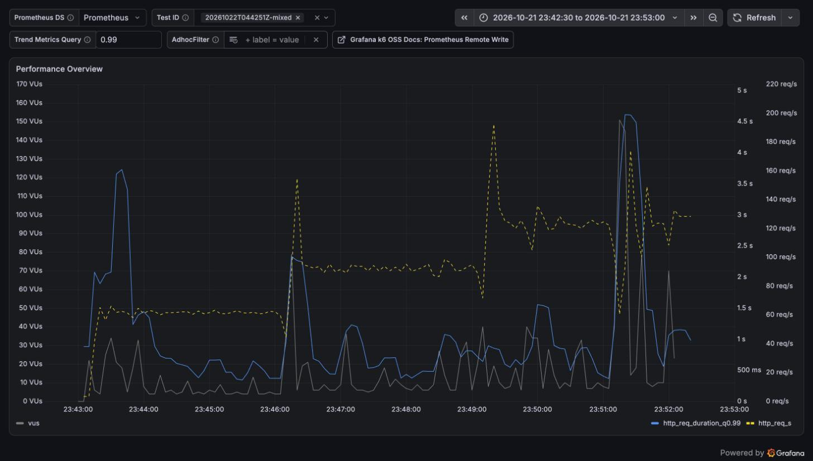
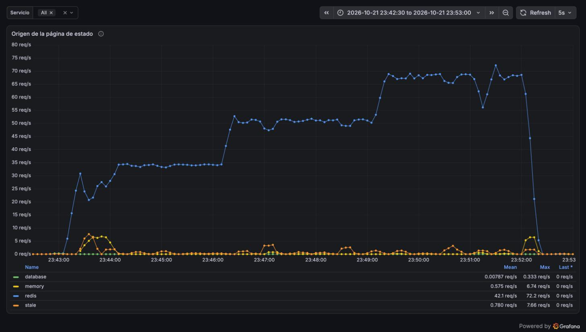
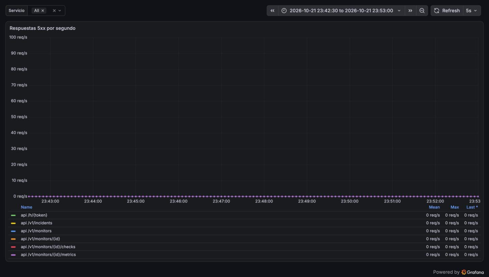
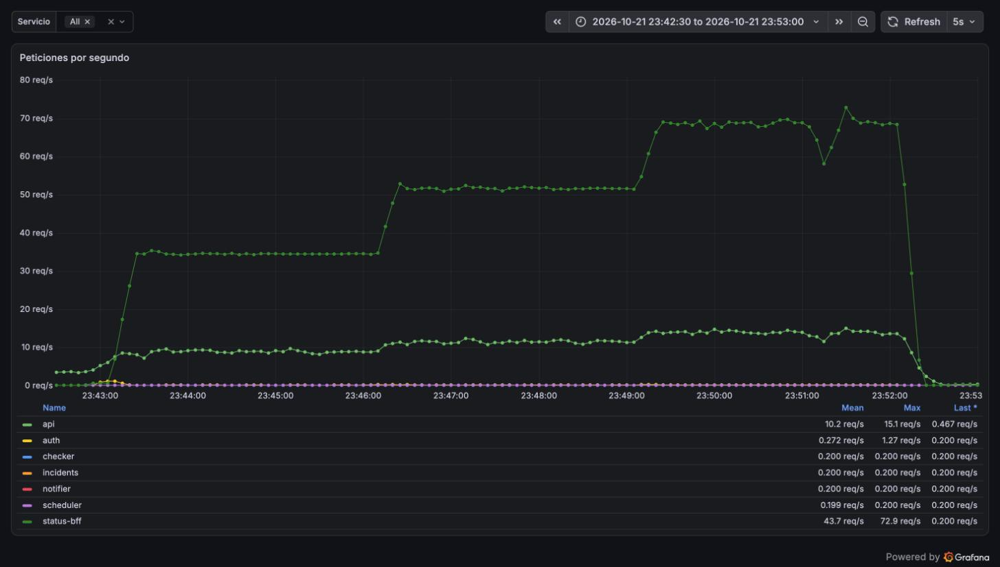

# Reporte de carga: prueba mixta con la copia en memoria de status-bff (2026-10-21)

| Campo     | Valor                                                                                                                               |
| --------- | ----------------------------------------------------------------------------------------------------------------------------------- |
| Fecha     | 2026-10-21 en hora del Mac (UTC−5); 04:43–04:52 UTC del 22                                                                          |
| Commit    | status-bff `652e39d` (`feat/status-page-stale`, imagen `sha-652e39d`); el resto `:main` (`a4328e2`)                                 |
| testid    | `20261022T044251Z-mixed`, comparado con `20261022T032408Z-mixed` (corrida 2 del [reporte](2026-10-21-vps-mixta.md))                 |
| k6        | 2.3.0 en contenedor en el Mac, contra https://taut.lat por internet (~90 ms de ida y vuelta)                                        |
| Veredicto | **Cero errores hasta 2×**, donde antes fallaba el 11,7 % de la página de estado y el 30 % del panel; la latencia sigue sobre el SLO |

## Resumen

La corrida 2 de la prueba mixta mostró que, con la CPU de la VPS agotada, las lecturas de Redis
vencían y cada petición armaba su página en PostgreSQL, hasta agotar el pool de conexiones. Ahora
cada proceso de status-bff guarda la última copia de cada página y, cuando Redis no la tiene o no
responde, la sirve mientras una sola tarea la reconstruye. Con la misma prueba, la misma VPS y
Caddy con 192 MB, a 2× no hubo un solo error en ningún tipo de tráfico y ninguna página salió de
la base después de las primeras cinco. El p95 que ve k6 a 2× bajó de 10,8 s a 1,3 s en la página de
estado y de 15,4 s a 2,0 s en el panel, pero sigue sobre los 300 ms del SLO: el límite que queda es
la CPU de la VPS, que se reparten Caddy, PostgreSQL y los servicios.

## Entorno

El mismo de la corrida 2 ([reporte](2026-10-21-vps-mixta.md)): la VPS de Oracle Cloud con 1/8 de
OCPU, Caddy con `CADDY_MEM_LIMIT=192m`, pool de 4 conexiones y caché de 30 s, la semilla
`mixed.sql` (20 tenants `lt-m-*`, 200 monitores a 60 s) y `SCALES=1,1.5,2`. Solo cambió la imagen
de status-bff (`STATUS_BFF_TAG=sha-652e39d`).

Diferencias con la corrida 2:

- Esta vez la prueba esperó a que la carga de la VPS bajara de 1 después de sembrar (la siembra
  incluye `VACUUM ANALYZE`); la corrida 2 empezó justo después. A 1× los números de esta corrida
  pueden ser algo mejores por eso; a 2× la diferencia es de otro orden.
- Antes de correr hubo que reiniciar auth: llevaba 60 de sus 64 MB y sus logins tardaban 3,8 s y
  devolvían 500 (ver «Qué se encontró»). Dos intentos anteriores se cortaron en el `setup()` por eso.

## Resultados

| Escalón | Página de estado: corrida 2 | Página de estado: ahora   | Panel: corrida 2             | Panel: ahora              |
| ------- | --------------------------- | ------------------------- | ---------------------------- | ------------------------- |
| 1×      | p95 496 ms, 0,02 % errores  | p95 527 ms, 0 errores     | p95 1,05 s, 0 errores        | p95 1,86 s, 0 errores     |
| 1,5×    | p95 556 ms, 0,06 % errores  | p95 564 ms, 0 errores     | p95 1,31 s, 0 errores        | p95 1,27 s, 0 errores     |
| 2×      | **p95 10,8 s, 11,7 %**      | p95 1,30 s, **0 errores** | **p95 15,4 s, 30 % errores** | p95 2,05 s, **0 errores** |

| Escalón | Visitas nuevas (p95) | Logins (p95) | Heartbeats                           | Lag < 10 s |
| ------- | -------------------: | -----------: | ------------------------------------ | ---------: |
| 1×      |               393 ms |       4,72 s | p95 1,19 s, 0 errores                |      100 % |
| 1,5×    |               388 ms |       5,67 s | p95 0,95 s, 0 errores                |      100 % |
| 2×      |               599 ms |       3,05 s | p95 1,57 s, 0 errores (antes 20,9 %) |      100 % |

- Iteraciones descartadas: 202 (2 025 en la corrida 2).
- A 2× k6 completó 119,5 req/s, contra 102 en la corrida 2: la VPS atendió toda la carga ofrecida.

## Lado servidor

Por escalón, desde Prometheus (promedio de los 3 min):

| Escalón | status-bff (req/s) | p95 de status-bff (corrida 2) | p95 de api (corrida 2) | 5xx (corrida 2) | Fallos de Redis: miss + error | Origen de las páginas                          |
| ------- | -----------------: | ----------------------------: | ---------------------: | --------------: | ----------------------------: | ---------------------------------------------- |
| 1×      |               34,5 |                 84 ms (86 ms) |        965 ms (539 ms) |           0 (0) |                      413 + 16 | redis 5 719, memory 221, stale 204, database 0 |
| 1,5×    |               51,8 |                 75 ms (95 ms) |        680 ms (826 ms) |           0 (4) |                      156 + 11 | redis 9 123, memory 13, stale 154, database 0  |
| 2×      |               68,2 |             78 ms (**8,2 s**) |     785 ms (**9,2 s**) |   0 (**1 465**) |                       244 + 0 | redis 12 002, memory 96, stale 148, database 0 |

| Medida (pico, `docker stats`) | Corrida 2 |  Ahora |
| ----------------------------- | --------: | -----: |
| CPU de status-bff             |    ~130 % |  ~59 % |
| CPU de PostgreSQL             |    ~380 % | ~215 % |
| CPU de Caddy                  |    ~326 % | ~233 % |
| Memoria de Caddy              |    167 MB | 114 MB |

- **Ninguna página salió de la base durante la carga.** El panel «Origen de la página de estado»
  marca `database` solo al arrancar (las cinco primeras construcciones, una por slug). Los cientos
  de fallos de Redis por escalón, por vencimiento o por timeout, se sirvieron desde la copia en
  memoria (`memory` dentro del TTL, `stale` vencida mientras se reconstruía).
- Sin páginas armadas por petición, PostgreSQL usa casi la mitad de CPU y el pool no se agota: ni
  status-bff ni la api devolvieron un 5xx, cuando antes hubo 1 666 `pool timed out`.
- La api también mejora a 2× (p95 785 ms frente a 9,2 s) aunque no cambió: compartía el
  PostgreSQL que la página de estado saturaba.

## Capturas

Tableros de Grafana en hora del Mac (UTC−5), de 23:42:30 a 23:53.

k6: los escalones de ~60, ~90 y ~120 req/s (amarillo) sin línea de errores. El p99 (azul) tiene
tres picos, de 3,7 s al arrancar, 2,3 s al pasar a 1,5× y 4,5 s a mitad del 2×, y se queda bajo
1,5 s el resto del tiempo.

Origen de la página de estado: casi todo sale de Redis (azul) y sigue a la carga hasta 70 por
segundo; la copia en memoria (amarillo) y la vieja (naranjo) cubren los vencimientos, y la base
(verde) se queda en cero salvo al arrancar.

Respuestas 5xx: ninguna en toda la corrida (en la corrida 2, status-bff llegó a 20 por segundo).

Peticiones por servicio: status-bff atiende 35, 52 y 69 req/s sin cortes, y la api hasta 15.

## Qué se encontró

- **La copia en memoria resuelve el agotamiento del pool.** A 2× la VPS ya no se cae: cero errores
  en la página de estado, el panel, los heartbeats y los logins, y la página tarda 78 ms en el
  servidor.
- **El techo ahora es la latencia, no los errores.** El p95 de k6 a 2× (1,3 s en la página de
  estado) queda muy por encima de los 78 ms del servidor: el resto es Caddy (TLS, compresión y
  estáticos en la misma CPU) y la red. Es lo que atacaría el proxy de Cloudflare.
- **auth acumula memoria hasta su límite.** Después de cientos de logins seguidos de las pruebas,
  auth llegó a 60 de sus 64 MB sin carga; cada login tardaba 3,8 s y la llamada a Redis que sigue
  al hash vencía con `redis: timed out`, así que el login devolvía 500. Un reinicio lo dejó en 14 MB.
  Cada hash Argon2id usa 19 MB: o la memoria del hash no vuelve al sistema operativo, o el límite
  de 64 MB es justo para dos logins a la vez. Hay que medirlo antes de elegir arreglo.
- **Los logins siguen lentos** (p95 de 3 a 5,7 s): Argon2id compite por la misma CPU.

## Cuellos de botella

| Síntoma                                  | Evidencia                                                    | Hipótesis                                                | Arreglo propuesto                                                                 |
| ---------------------------------------- | ------------------------------------------------------------ | -------------------------------------------------------- | --------------------------------------------------------------------------------- |
| p95 de k6 de 1,3 s con 78 ms en servidor | Caddy ~233 % de CPU a 2×                                     | TLS, compresión y estáticos de Caddy en la CPU de la VPS | Proxy de Cloudflare para estáticos y `/s/*`                                       |
| Logins con 500 tras muchas pruebas       | auth en 60 de 64 MB sin carga; `redis: timed out` tras 3,8 s | La memoria de Argon2id no vuelve o el límite es justo    | Medir la memoria de auth por login; subir el límite o limitar los hashes a la vez |

## Cambios en la VPS

- status-bff corre la imagen `sha-652e39d` de la rama, puesta con `STATUS_BFF_TAG` al recrear solo
  ese servicio; un `docker compose up -d` sin la variable vuelve a `:main`.
- auth se reinició a las 04:41 UTC.
- Los tenants `lt-m-*` se borraron al terminar (`vps-demo.sh mixta-limpiar`).
