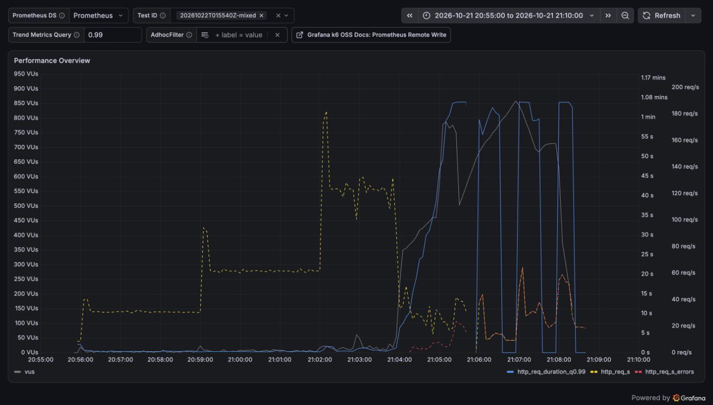
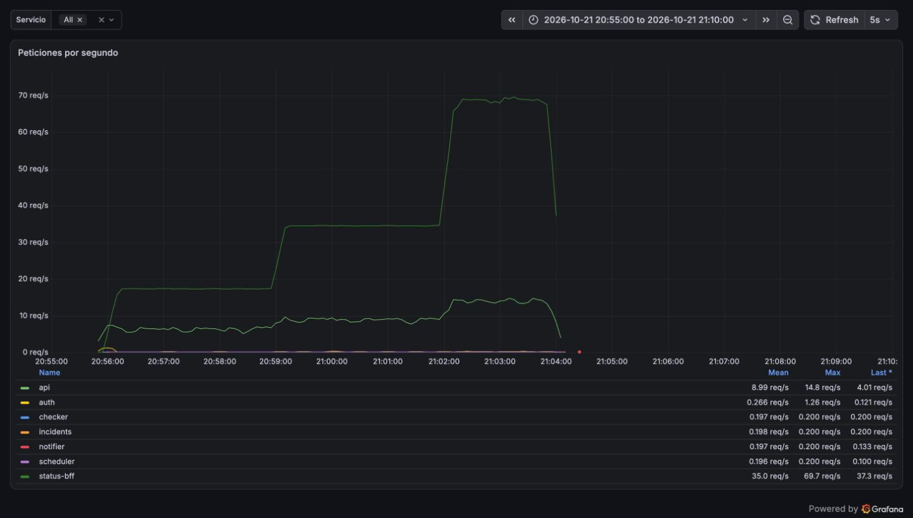
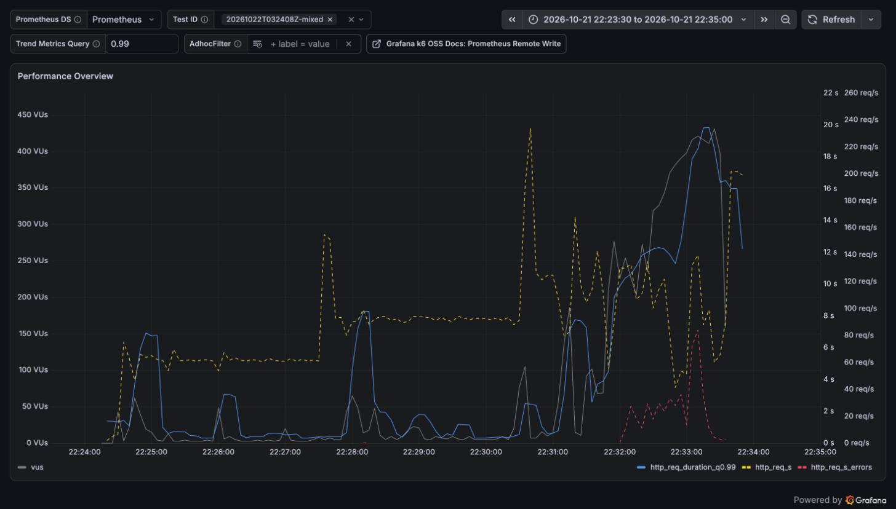
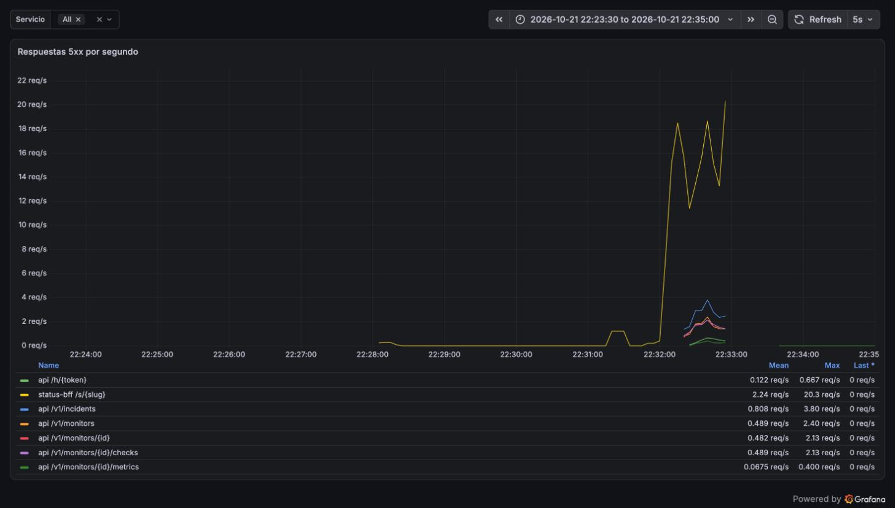
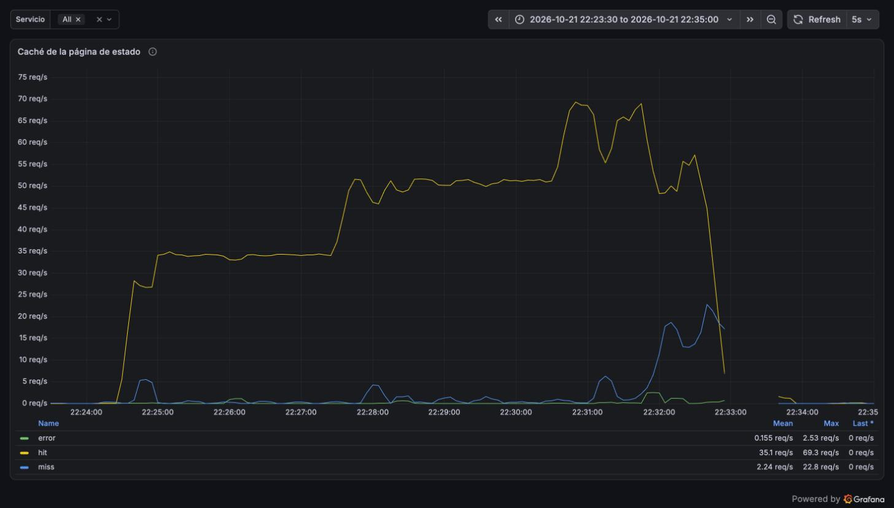

# Reporte de carga: prueba mixta en la VPS (2026-10-21)

| Campo     | Valor                                                                                                       |
| --------- | ----------------------------------------------------------------------------------------------------------- |
| Fecha     | 2026-10-21 en hora del Mac (UTC−5); 01:55–03:34 UTC del 22                                                  |
| Commit    | `a4328e2` en la VPS (imágenes `:main`); escenario en `feat/loadtest-mixed`                                  |
| testid    | `20261022T015540Z-mixed` (Caddy con 128 MB) y `20261022T032408Z-mixed` (192 MB)                             |
| k6        | 2.3.0 en contenedor en el Mac, contra https://taut.lat por internet (~90 ms de ida y vuelta)                |
| Veredicto | **Techo en 1×**: ~1 000 pestañas de estado y 20 usuarios de panel; a 2× se cae, y con 128 MB no se recupera |

## Resumen

Las pruebas anteriores cargaban un servicio a la vez. Esta pone todo junto en la VPS de la demo y
cuenta personas en vez de peticiones: pestañas de la página de estado, visitas nuevas que bajan los
archivos del panel, usuarios del panel, logins reales, heartbeats y 200 monitores chequeándose de
fondo. Una unidad (1×) son 1 000 pestañas de estado abiertas y 20 personas en el panel, unas 62
req/s, y la VPS la atiende dentro del SLO en la primera corrida y apenas fuera en la segunda: es el
borde, no un nivel cómodo. A 2× (~123 req/s ofrecidas) todo se cae: no cede Taut, cede Caddy, que
gasta casi toda la CPU mientras api y status-bff esperan. Con su límite de 128 MB, Caddy quedó
atascado y el sitio estuvo caído unos 20 minutos, hasta que el proceso se cayó y Docker lo reinició.
Con 192 MB llegó a 167 MB, no se cayó y el sitio respondió apenas bajó la carga, pero el techo no
subió: lo pone la CPU. Con Caddy ya sin ahogarse, a 2× las peticiones llegaron a los servicios y
apareció el límite siguiente: la CPU escasa hizo vencer las lecturas de Redis, las páginas se
armaron desde PostgreSQL todas a la vez y status-bff y api se quedaron sin conexiones del pool.

## Entorno

| Campo         | Valor                                                                                                                                    |
| ------------- | ---------------------------------------------------------------------------------------------------------------------------------------- |
| Servidor      | VPS de Oracle Cloud: 1/8 de OCPU AMD EPYC 7551 (2 vCPU visibles), 954 MB de RAM y 2 GB de swap                                           |
| Despliegue    | Docker compose con las imágenes de GHCR (`:main`, commit `a4328e2`); Caddy 2.10 con TLS y `encode zstd gzip`                             |
| Configuración | Pool de 4 conexiones por servicio, caché de páginas de 30 s, logs `info`, límite de memoria por contenedor                               |
| Datos         | 5 páginas de estado (`lt-s-01`…`05`); 20 tenants `lt-m-*` con dueño, 10 monitores a 60 s y 7 días de historia a 5 min (`seed/mixed.sql`) |
| Cliente       | `loadtest/vps-demo.sh mixta` con `caffeinate -i`; `docker stats` de la VPS cada ~15–40 s a un archivo                                    |

- Los monitores `lt-m-*` chequean `https://taut.lat/v1/ping`: la VPS no deja chequear direcciones
  internas, así que cada chequeo sale a internet y vuelve a entrar por Caddy. Son 3,3 chequeos/s
  que un chequeo real a un sitio ajeno no le cargaría a Caddy.
- `docker stats` cuenta la CPU sobre los 2 vCPU visibles, pero la VPS tiene 1/8 de OCPU garantizado
  y mucho tiempo robado por el hipervisor: los porcentajes sirven para comparar, no son absolutos.
- Las métricas del servidor llegan a Prometheus por un túnel SSH a `127.0.0.1:9100`, que también
  sirve Caddy: cuando Caddy deja de responder, Prometheus queda ciego.

## Escenario

`loadtest/scenarios/mixed.js`. Cada tipo de tráfico copia lo que hace el navegador: la página de
estado se consulta cada 30 s; en el panel, la mitad de las personas mira la lista de monitores
(cada 10 s) y la otra mitad un detalle (monitor, chequeos e incidentes a la vez cada 10 s, métricas
cada 60 s), y todos tienen el contador de incidentes abiertos de la barra lateral (cada 30 s).

| Tráfico             | Por unidad (1×)                                                     | Peticiones/s a 1× |
| ------------------- | ------------------------------------------------------------------- | ----------------: |
| Pestañas de estado  | 1 000, cada una `GET /s/{slug}` cada 30 s                           |              33,3 |
| Visitas nuevas      | 60 por minuto: HTML, los 21 archivos que precarga y `GET /s/{slug}` |                23 |
| Panel               | 20 personas                                                         |               4,8 |
| Logins (Argon2id)   | 2 por minuto                                                        |              0,03 |
| Heartbeats          | 20 por minuto (`POST /h/{token}`)                                   |              0,33 |
| Chequeos (de fondo) | 200 monitores a 60 s, igual en todos los escalones                  |               3,3 |

Escalones de 3 min sin rampa. Umbrales por escalón: p95 < 300 ms y errores < 1 % en página de
estado y panel; errores < 1 % en visitas nuevas, logins y heartbeats (su latencia solo se reporta);
99,5 % de los chequeos con lag < 10 s, leído de Prometheus cada 15 s. k6 no tiene caché HTTP, así
que cada visita nueva baja todos los archivos, y no pide los trozos que la app importa después: ese
tráfico es un mínimo.

## Resultados

Corrida 1, Caddy con 128 MB (`SCALES=0.5,1,2,3`):

| Escalón | Pestañas | Panel | p95 estado | Errores estado |  p95 panel | Errores panel | p95 login |  Lag < 10 s |
| ------- | -------: | ----: | ---------: | -------------: | ---------: | ------------: | --------: | ----------: |
| 0,5×    |      500 |    10 |     159 ms |              0 | **399 ms** |             0 |    905 ms |       100 % |
| 1×      |    1 000 |    20 |     157 ms |              0 |     287 ms |             0 |    888 ms |       100 % |
| 2×      |    2 000 |    40 | **13,0 s** |      **1,8 %** | **22,4 s** |    **15,0 %** |    32,0 s |       100 % |
| 3×      |    3 000 |    60 |   **60 s** |     **~100 %** |   **56 s** |    **~100 %** |      60 s | sin datos ¹ |

Corrida 2, Caddy con 192 MB (`SCALES=1,1.5,2`), una hora después:

| Escalón | Pestañas | Panel | p95 estado | Errores estado |  p95 panel | Errores panel | p95 login | Lag < 10 s |
| ------- | -------: | ----: | ---------: | -------------: | ---------: | ------------: | --------: | ---------: |
| 1×      |    1 000 |    20 | **496 ms** |         0,02 % | **1,05 s** |             0 |    3,98 s |      100 % |
| 1,5×    |    1 500 |    30 | **556 ms** |         0,06 % | **1,31 s** |             0 |    3,11 s |      100 % |
| 2×      |    2 000 |    40 | **10,8 s** |     **11,7 %** | **15,4 s** |    **30,4 %** |    7,42 s |      100 % |

En negrita lo que no cumple el SLO. ¹ A 3× Caddy ya no respondía y el túnel de métricas pasa por
él: Prometheus no recibió chequeos que medir.

- Las visitas nuevas cumplieron hasta 1,5× (p95 de 263 a 365 ms) y a 2× subieron a 5–10 s.
- La corrida 1 descartó 20 905 iteraciones, casi todas a 2× y 3×; la 2, 2 025.
- **Los heartbeats fallaron antes que nada en la corrida 2:** 20,9 % de errores a 2×, frente al
  8,4 % de la corrida 1.

## Lado servidor

| Medida (pico, `docker stats`) | Corrida 1 (128 MB)                                  | Corrida 2 (192 MB)                |
| ----------------------------- | --------------------------------------------------- | --------------------------------- |
| Memoria de Caddy              | 126 MB, pegado al límite desde el escalón 2×        | 167 MB a 2×                       |
| CPU de Caddy                  | ~196 % a 2×                                         | ~326 % a 2×                       |
| CPU de PostgreSQL             | ~110 % a 0,5× y ~90 % a 2×                          | ~380 % a 2×                       |
| CPU de api y status-bff       | ~0 % desde las 02:04:30: no les llegaban peticiones | hasta ~130 % (status-bff)         |
| Reinicios                     | Caddy, a las 02:24:57, sin OOM del kernel           | ninguno                           |
| Después de la carga           | sitio caído ~20 min, hasta el reinicio de Caddy     | responde en 0,5–1,1 s al terminar |
| Swap de la VPS                | de 204 a 521 MB                                     | —                                 |

- En la corrida 1 los registros de Caddy muestran 201 `dial tcp: lookup api: i/o timeout`, 25 de
  `status-bff` y 82 `dial tcp 172.20.0.8:8080: i/o timeout`: como el 21-10, no alcanza a
  resolver ni a conectarse a los servicios en la red de Docker cuando está saturado.
- Diez minutos después de la carga, Caddy seguía en 123 MB y no respondía ni desde la propia VPS
  (`curl --resolve` a 127.0.0.1), con la carga del sistema bajando de 11 a 4,8. Se recuperó solo
  cuando el proceso se cayó y Docker lo reinició (`RestartCount` 1, `OOMKilled` falso).
- Los registros de Caddy de la corrida 1 se perdieron con el reinicio.

Por escalón, desde Prometheus (promedio de los 3 min del escalón; las métricas de los servicios
llegan por el túnel, que pasa por Caddy):

| Corrida y escalón | k6 (req/s) | status-bff (req/s) | p95 de status-bff | api (req/s) | p95 de api | Aciertos de caché | 5xx en el escalón |
| ----------------- | ---------: | -----------------: | ----------------: | ----------: | ---------: | ----------------: | ----------------: |
| 1: 0,5×           |         31 |               17,4 |              5 ms |         6,4 |     205 ms |            98,8 % |                 0 |
| 1: 1×             |         62 |               34,6 |              5 ms |         9,0 |     132 ms |            99,3 % |                 0 |
| 1: 2×             |         90 |               49,3 |             91 ms |         9,4 |     606 ms |            99,2 % |                 0 |
| 1: 3×             |         18 |          sin datos |         sin datos |   sin datos |  sin datos |         sin datos |         sin datos |
| 2: 1×             |         61 |               34,4 |             86 ms |         9,0 |     539 ms |            97,8 % |                 0 |
| 2: 1,5×           |         92 |               51,6 |             95 ms |        11,5 |     826 ms |            98,2 % |                 4 |
| 2: 2×             |        102 |               52,1 |         **8,2 s** |        10,9 |  **9,2 s** |        **84,8 %** |         **1 465** |

- **Corrida 1:** a 2× status-bff atendía 69 req/s con un p95 de milisegundos hasta las 02:04; ahí
  el túnel de métricas se corta y desde entonces no hay datos. No hubo una sola respuesta 5xx de
  Taut: las peticiones se quedaban en Caddy.
- **Corrida 2:** a 2× los 5xx empiezan a las 03:32, minuto y medio después de empezar el escalón:
  1 055 de `/s/{slug}` en status-bff y 410 de la api, repartidos entre `/v1/incidents`,
  `/v1/monitors`, el detalle, los chequeos, `/h/{token}` y las métricas. En los registros son
  1 666 `pool timed out while waiting for an open connection` y 81 `redis: timed out`.
- En ese mismo escalón hubo 1 359 fallos de caché en 3 min, cuando 5 páginas que vencen cada 30 s
  necesitan unos 30: con la CPU agotada, las lecturas de Redis pasan su timeout de 250 ms, cada
  petición arma la página desde PostgreSQL y el pool de 4 conexiones se acaba.

## Capturas

Tableros de Grafana en hora del Mac (UTC−5): la corrida 1 es de 20:55 a 21:10 y la 2 de 22:23 a
22:35.

Corrida 1 en k6: los escalones de 31, 62 y ~125 req/s (amarillo). A las 21:04, dos minutos dentro
del 2×, la tasa cae, el p99 (azul) sube al timeout de 1 min, k6 llega a ~850 VUs (gris) y aparecen
los errores (rojo), que siguen durante el 3×.

Corrida 1 en el servidor: status-bff sube a 17, 35 y 69 req/s y la api a unos 14. Las líneas se
cortan a las 21:04, cuando Caddy deja de responder y con él el túnel de métricas.

Corrida 2 en k6: el p99 tiene saltos de 6–8 s en cada cambio de escalón y desde las 22:31 sube a
20 s; los errores aparecen a las 22:32.

Corrida 2, respuestas 5xx: status-bff llega a 20 por segundo y la api a unas 4 en cada ruta del
panel, todas desde las 22:32.

Corrida 2, caché de la página de estado: los aciertos (amarillo) siguen a la carga hasta 69 por
segundo; a las 22:32 los fallos (azul) suben a 22 por segundo junto con los errores de Redis
(verde), justo cuando empiezan los 5xx.

## Qué se encontró

- **El techo de la VPS con tráfico mezclado está cerca de 1×.** Con la página de estado sola el
  techo era 200 req/s; mezclado es ~62–90 req/s. Las visitas nuevas pesan mucho: cada una son 23
  peticiones, y a 1× ya son el 37 % del tráfico.
- **Con 128 MB cede Caddy, no Taut.** En la corrida 1, a los dos minutos del 2×, Caddy deja de
  pasar peticiones: api y status-bff quedan casi ociosos y sin un solo 5xx, mientras Caddy gasta
  la CPU en TLS, compresión y archivos estáticos y no llega a resolver los servicios en el DNS de
  Docker.
- **Sin ese tapón, el siguiente límite es el pool de conexiones.** En la corrida 2 las peticiones
  sí llegan, y con la CPU agotada las lecturas de Redis vencen, la caché falla 45 veces más de lo
  esperado y status-bff y api se quedan sin conexiones (1 666 `pool timed out`). Es el pendiente
  del 21-10 de que una página vencida se arme una sola vez, ahora con evidencia: si Redis tarda,
  conviene servir la página vieja o esperar a la reconstrucción en curso antes que ir a la base.
- **Con 128 MB, Caddy no se recupera solo.** Queda atascado en su límite de memoria y el sitio
  entero (panel, página de estado, heartbeats y métricas) queda caído hasta que el proceso se cae,
  unos 20 minutos después.
- **Con 192 MB sí se recupera, pero no rinde más.** Caddy necesitó 167 MB a 2×, más que el límite
  anterior. El sitio respondió apenas bajó la carga, pero a 2× los errores siguieron (11,7 % en la
  página de estado) porque el límite es la CPU de 1/8 de OCPU, que se reparten Caddy, PostgreSQL y
  status-bff.
- **Las dos corridas a 1× no coinciden.** La primera cumple el SLO (157 y 287 ms); la segunda no
  (496 ms y 1,05 s), con PostgreSQL al 270 % en el primer minuto. Antes de la segunda se borraron y
  se volvieron a sembrar unas 400 000 filas (`VACUUM ANALYZE` incluido), y la VPS venía de otra
  corrida: la segunda probablemente midió una VPS más lenta. La comparación de memoria vale para
  el 2×, que en las dos corridas se cae.
- **Los logins aguantan pero se ponen lentos.** Ninguno falló; el p95 pasó de 0,9 s a 3–4 s en la
  corrida 2 y a 32 s a 2× en la 1. Cada hash usa 19 MB y auth tiene 64 MB: tres logins a la vez se
  acercan a su límite.

## Cuellos de botella

| Síntoma                                    | Evidencia                                                                                     | Hipótesis                                                                                | Arreglo propuesto                                                                                                   |
| ------------------------------------------ | --------------------------------------------------------------------------------------------- | ---------------------------------------------------------------------------------------- | ------------------------------------------------------------------------------------------------------------------- |
| A 2× se cae todo el sitio                  | Caddy ~200–330 % de CPU; api y status-bff ociosos                                             | TLS, compresión y estáticos de Caddy agotan la CPU de la VPS                             | Proxy de Cloudflare: estáticos y `/s/*` (ya con `max-age=30`) servidos desde su red                                 |
| Con 128 MB el sitio no vuelve en 20 min    | Caddy en 123–126 MB, sin responder ni en local, reinicio a las 02:24:57                       | El límite de memoria deja a Caddy atascado en vez de liberarlo                           | Dejar Caddy en 192 MB (`CADDY_MEM_LIMIT` en el `.env` de la VPS) y probar `GOMEMLIMIT`                              |
| Caddy no resuelve los servicios bajo carga | `lookup api: i/o timeout`, igual que el 21-10                                                 | Cada conexión nueva hacia los servicios pasa por el DNS de Docker                        | Más conexiones reutilizables de Caddy hacia los servicios (`keepalive`); medir de nuevo                             |
| Con Caddy sano, a 2× se agota el pool      | 1 359 fallos de caché en 3 min (~30 esperados), 81 `redis: timed out`, 1 666 `pool timed out` | Con la CPU agotada Redis pasa su timeout y cada petición arma la página desde PostgreSQL | Single-flight por página y servir la copia vencida mientras se reconstruye; 503 con `Retry-After` al agotar el pool |
| Los chequeos de la prueba cargan a Caddy   | 3,3 chequeos/s a `https://taut.lat/v1/ping`                                                   | El destino es la propia VPS                                                              | Un destino externo propio para los monitores de prueba                                                              |

## Cambios en la VPS

- `compose.yml` toma el límite de Caddy de `${CADDY_MEM_LIMIT:-128m}` (respaldo
  `compose.yml.bak-2026-10-22`). La corrida 2 recreó Caddy con `CADDY_MEM_LIMIT=192m` y quedó
  así; un `docker compose up -d` sin la variable lo devuelve a 128 MB.
- Los tenants `lt-m-*` se borraron al terminar cada corrida (`vps-demo.sh mixta-limpiar`).
