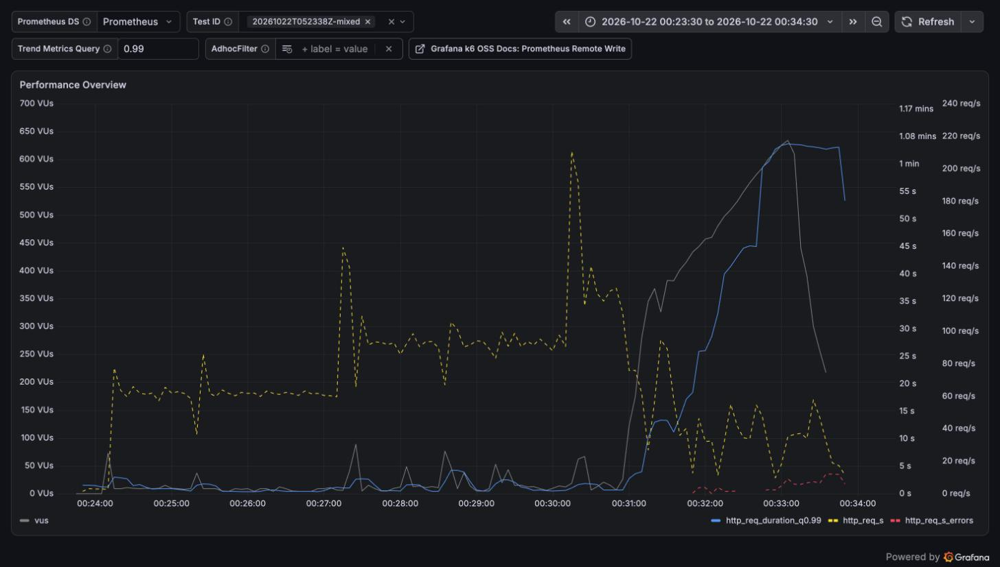
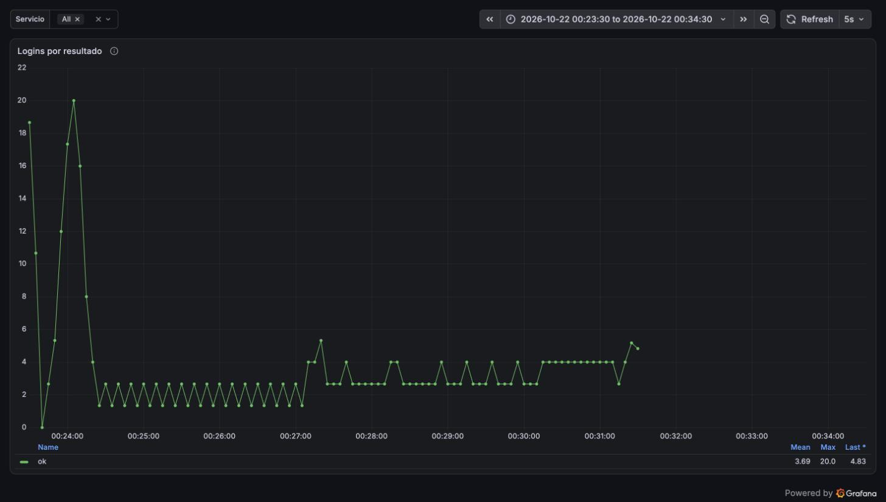
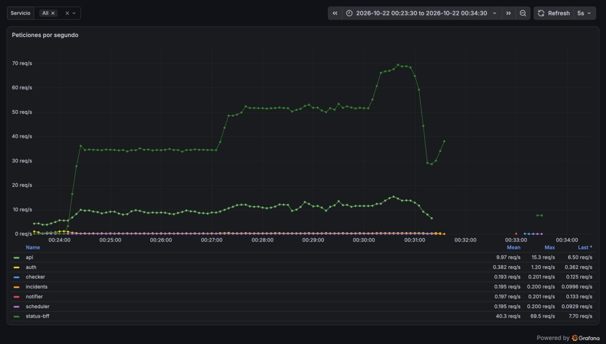

# Reporte de carga: memoria de auth con logins simultáneos (2026-10-22)

| Campo     | Valor                                                                                                              |
| --------- | ------------------------------------------------------------------------------------------------------------------ |
| Fecha     | 2026-10-22, 05:00–05:34 UTC (00:00–00:34 en el Mac, UTC−5)                                                         |
| Commit    | auth `f6fd044` (`fix/auth-hash-memory`, imagen `sha-f6fd044`); status-bff `sha-652e39d` (#37); el resto `:main`    |
| testid    | `20261022T052338Z-mixed`, más ráfagas de logins con `curl`                                                         |
| k6        | 2.3.0 en contenedor en el Mac, contra https://taut.lat por internet                                                |
| Veredicto | **auth ya no se queda sin memoria**: 16 logins a la vez sin OOM y de vuelta a 3–5 MB; a 2× de la mixta cedió Caddy |

## Resumen

En la prueba con la copia de status-bff, auth llegó a 60 de sus 64 MB sin carga y sus logins
devolvían 500. La causa es glibc: cada hash Argon2id pide 19 MB, glibc sube su umbral de mmap la
primera vez que libera un bloque así, y desde ahí guarda los siguientes en el heap sin devolverlos.
Además no había tope de hashes simultáneos, así que cuatro logins a la vez (también con contraseñas
erróneas) sumaban 76 MB y el kernel mataba el contenedor. El arreglo fija el umbral de mmap en la
imagen y deja correr como máximo dos hashes a la vez. En local y en la VPS auth aguanta ráfagas de
8 y 16 logins sin OOM y vuelve a pocos MB. En la prueba mixta con el triple de logins no falló
ninguno; a 2× la VPS se cayó otra vez, pero por Caddy, que llegó a su límite de 192 MB.

## Experimento en local

auth con 64 MB y sin swap (`docker run -m 64m --memory-swap 64m`), la imagen de main y la nueva,
contra el PostgreSQL y el Redis de `just up`. Ráfagas de N logins a la vez con `curl`; la memoria
es la de `docker stats` después de cada ráfaga.

| Ráfagas             | Imagen de main               | Con `MALLOC_MMAP_THRESHOLD_` solo | Imagen nueva (umbral + 2 hashes a la vez) |
| ------------------- | ---------------------------- | --------------------------------- | ----------------------------------------- |
| 3 logins seguidos   | 41 MB retenidos              | 3 MB                              | 3 MB                                      |
| 2 a la vez, 3 veces | 41 MB y a la tercera **OOM** | 3 MB, todas 200                   | 3 MB, todas 200                           |
| 3 a la vez, 3 veces | 60 MB y después **OOM**      | 3 MB, todas 200                   | 3 MB, todas 200                           |
| 4 a la vez          | **OOM**                      | **OOM** (4 × 19 MB)               | 3–4 MB, todas 200                         |
| 8 y 16 a la vez     | —                            | —                                 | 4–5 MB, todas 200                         |

- `MALLOC_ARENA_MAX=1` no cambió nada (41 MB tras 3 logins): el problema es el umbral, no las
  arenas por hilo.
- Pico de memoria (`memory.peak` del cgroup): 54 MB con 2 contraseñas erróneas a la vez en la
  imagen de main; 55,6 MB con 16 a la vez en la nueva. El tope deja el pico en el de dos hashes
  sin importar cuántos lleguen, pero el margen hasta 64 MB es de unos 8 MB.
- El test `no_more_than_the_limit_hash_at_once` lanza 8 verificaciones y comprueba que nunca
  corren más de 2; sin el semáforo falla.

## En la VPS

Solo auth con la imagen nueva (`TAG=sha-f6fd044`, recreando ese servicio). En la VPS el contenedor
tiene 64 MB más 64 MB de swap: por eso antes no moría, sino que pasaba a swap, tardaba 3,8 s por
login y la llamada a Redis después del hash vencía.

- Tres ráfagas de 8 logins a la vez (cuentas `lt-m-01`…`08`): las 24 respondieron 200, en 1,5 a
  5,2 s porque esperan su turno; auth terminó en 4,8 MB, con un pico de 52 MB y sin reinicios.
- Prueba mixta (`SCALES=1,1.5,2`, `LOGINS_PER_MIN=6`, el triple de la habitual):

| Escalón | Página de estado      | Panel                 | Logins              | Heartbeats            |
| ------- | --------------------- | --------------------- | ------------------- | --------------------- |
| 1×      | p95 607 ms, 0 errores | p95 1,15 s, 0 errores | p95 2,29 s, 0 de 19 | p95 1,0 s, 0 errores  |
| 1,5×    | p95 1,02 s, 0 errores | p95 2,54 s, 0 errores | p95 2,38 s, 0 de 27 | p95 1,78 s, 0 errores |
| 2×      | **p95 32 s, 1,2 %**   | **p95 60 s, 25 %**    | p95 36 s, 3 de 34   | **p95 31 s, 5,7 %**   |

- auth estuvo entre 3 y 6 MB toda la corrida, con un hash a la vez como máximo
  (`password_hashes_in_flight`), un pico de 52 MB y ningún 5xx.
- A 2×, status-bff y la api respondían (p95 de 165 ms y 1,9 s a las 05:31:35) sin un solo 5xx,
  mientras la memoria de Caddy subía de 87 a **191,8 de 192 MB** y su CPU pasaba de 180 %. Desde las
  05:32 Caddy dejó de pasar peticiones y el túnel de métricas se cortó. Se recuperó solo al bajar la
  carga, sin reiniciarse (58 MB a las 05:35).
- En la corrida anterior con la misma imagen de status-bff y un tercio de los logins, Caddy llegó a
  114 MB y 2× no tuvo errores: 2× es el borde de esta VPS, y una variación de la VPS o un poco más de
  CPU (los hashes) basta para cruzarlo.

## Capturas

Tableros de Grafana en hora del Mac (UTC−5), de 00:23:30 a 00:34:30.

k6: los escalones de ~60 y ~90 req/s se sostienen; a las 00:31, un minuto dentro del 2×, la tasa
cae, el p99 sube al timeout de 1 min, k6 llega a ~630 VUs y aparecen los errores.

Logins por resultado: todos `ok`. El pico del arranque son los 20 logins del `setup()`; después, 6,
9 y 12 por minuto según el escalón, hasta que se corta el túnel de métricas.

Peticiones por servicio: status-bff sube a 35, 52 y 69 req/s y cae a las 00:31 junto con la api,
cuando Caddy deja de pasarles peticiones.

## Qué se encontró

- **La memoria de auth era de glibc, no una fuga de Taut.** Con el umbral de mmap fijo, los 19 MB
  de cada hash vuelven al sistema al terminar.
- **Sin tope, unos pocos logins tumbaban auth**, y servían contraseñas erróneas: el límite por IP
  deja pasar 20 fallos cada 15 min. Con dos hashes a la vez el resto espera su turno, sin errores.
- **El margen de memoria es corto.** Con 2 hashes el pico es de 52–56 MB de 64. En la VPS, con
  1/8 de OCPU, dos hashes en paralelo no rinden más que uno; `TAUT_AUTH__MAX_CONCURRENT_HASHES=1`
  daría ~19 MB más de margen sin perder capacidad.
- **2× sigue siendo el borde por Caddy.** Ahora sin errores de Taut: lo que se cae es el proxy.

## Cambios en la VPS

- auth corre `sha-f6fd044`, puesta con `TAG` al recrear solo ese servicio; un `docker compose up -d`
  sin la variable vuelve a `:main`.
- status-bff sigue en `sha-652e39d` (#37) y Caddy en 192 MB.
- Los tenants `lt-m-*` se borraron al terminar.
