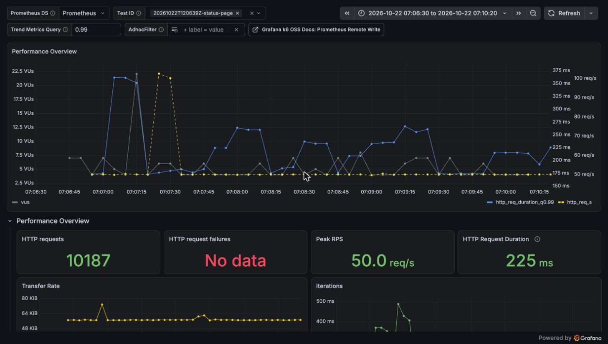
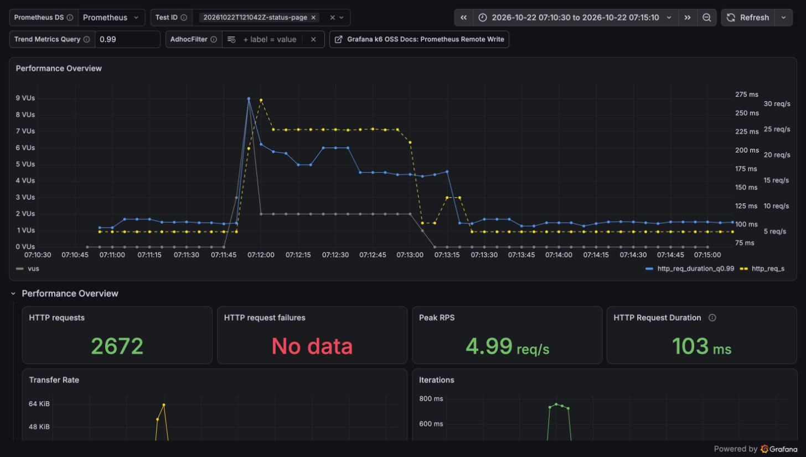
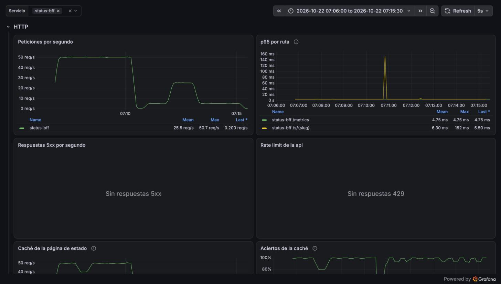
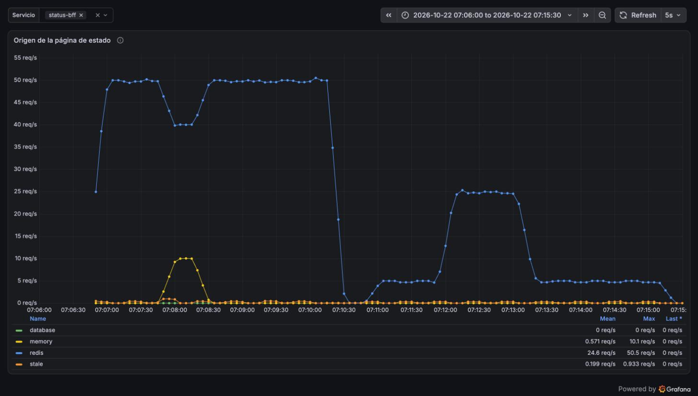

# Reporte de carga: la demo del 20-10 repetida en la VPS (2026-10-22)

| Campo     | Valor                                                                                               |
| --------- | --------------------------------------------------------------------------------------------------- |
| Fecha     | 2026-10-22, 12:06–12:15 UTC                                                                         |
| Commit    | imágenes de `main` en `1331a21` (caché #35, copia en memoria #37, auth #38)                         |
| testid    | sostenida: `20261022T120639Z-status-page`; pico: `20261022T121042Z-status-page`                     |
| k6        | 2.3.0 en contenedor en el Mac, contra https://taut.lat por internet (~90 ms de ida y vuelta)        |
| Veredicto | **Pasan las dos**: la carga sostenida, que el 20-10 fallaba con 28,5 % de errores, ya cumple el SLO |

## Resumen

Se repitieron las dos pruebas de la demo del 20-10 (sección «Demo en la VPS» del Google Doc) con los mismos datos y el
mismo comando (`loadtest/vps-demo.sh ambas`), para ver qué cambió con todo lo que entró a `main`
desde entonces. La carga sostenida de 50 req/s pasa de un p95 de 8,9 s y 28,5 % de errores a un
p95 de 166 ms sin errores ni iteraciones descartadas. El pico, que ya pasaba, sigue sin errores.
Ninguna página salió de PostgreSQL: status-bff las sirvió desde Redis o desde su copia en memoria
y las armó en 5 ms (p95). Casi todo lo que mide k6 es la red entre el Mac y la VPS.

## Entorno

| Campo         | Valor                                                                                          |
| ------------- | ---------------------------------------------------------------------------------------------- |
| Servidor      | VPS de Oracle Cloud: 1/8 de OCPU AMD EPYC 7551 (2 vCPU visibles), 954 MB de RAM y 2 GB de swap |
| Despliegue    | Docker compose con las imágenes de GHCR (`:main`, `1331a21`) y Caddy con TLS (192 MB)          |
| Configuración | Pool de 4 conexiones por servicio, caché de 30 s, copia en memoria hasta 5 min vencida         |
| Datos         | Los del 20-10: 5 páginas de estado (`lt-s-01`…`05`) con 5 monitores y 30 días de historia      |
| Cliente       | k6 en el Mac (`loadtest/vps-demo.sh`), Prometheus y Grafana locales por un túnel SSH           |

- Con la VPS en reposo antes de empezar (carga 0,3) y sin los tenants de la prueba mixta, que ya se
  habían borrado.
- 30 s de pausa entre la sostenida y el pico, como el 20-10.
- CPU y memoria por contenedor con `docker stats` cada ~10 s.
- **Una corrida descartada.** Un intento anterior del mismo día (`20261022T071320Z-status-page`)
  arrancó a las 07:13 UTC y terminó a las 12:01: el Mac entró en reposo en medio y una petición
  "tardó" 5,3 h. No se usa.

## Resultados

Carga sostenida: 30 s de rampa y 3 min a 50 req/s sobre las 5 páginas.

| Medida (fase estable)   |      20-10 (`dede0c4`) | 22-10 (`1331a21`) |
| ----------------------- | ---------------------: | ----------------: |
| Peticiones y errores    | 2 498 errores (28,5 %) |  9 000, 0 errores |
| Iteraciones descartadas |                    276 |                 0 |
| p50                     |                      — |             90 ms |
| p95                     |                  8,9 s |            166 ms |
| p99                     |                      — |            218 ms |
| VUs de k6 (máximo)      |                      — |               300 |

Pico: 1 min a 5 req/s, 1 min a 25 req/s (con 10 s de subida y de bajada) y 2 min a 5 req/s.

| Fase              | 20-10                 | 22-10                                     |
| ----------------- | --------------------- | ----------------------------------------- |
| Antes (5 req/s)   | p95 129 ms, 0 errores | p95 95 ms, 0 errores                      |
| Pico (25 req/s)   | 0 errores             | p95 ~155 ms, p99 ~186 ms, 0 errores       |
| Después (5 req/s) | p95 130 ms, 0 errores | p95 96 ms, 0 errores                      |
| Toda la corrida   | p95 153 ms            | p95 144 ms, 0 errores en 2 705 peticiones |

k6 no etiqueta el tramo del pico; su p95 sale del histograma de k6 en Prometheus y es aproximado.

### En el servidor, durante la sostenida

| Medida                           | 20-10                                   | 22-10                                              |
| -------------------------------- | --------------------------------------- | -------------------------------------------------- |
| p95 de status-bff en `/s/{slug}` | ~9,7 s                                  | 5 ms                                               |
| Respuestas 5xx                   | hasta 30 por segundo («pool timed out») | 0                                                  |
| Origen de las páginas            | PostgreSQL                              | Redis 8 645, memoria 309, copia vencida 49, base 0 |
| Pico de memoria de Caddy         | —                                       | 64 MB de 192                                       |

CPU máxima por contenedor en las dos corridas: PostgreSQL 51 %, Caddy 40 %, Redis 32 % y
status-bff 5 %. Redis ya estaba en 18–20 % con la VPS en reposo. En esta VPS el hipervisor roba
mucho tiempo y los porcentajes solo sirven para comparar.

## Capturas

Tableros de Grafana en hora del Mac (UTC−5).

Carga sostenida en k6: 50 req/s (amarillo) sin errores. El p99 (azul) queda entre 175 y 265 ms;
el salto a ~350 ms es la rampa del arranque, cuando k6 alcanza la tasa.



Pico en k6: la tasa sube de 5 a 25 req/s durante un minuto. El p99 llega a 270 ms al subir, baja a
~175 ms en el pico y vuelve a ~100 ms en cuanto la carga baja.



status-bff en el servidor durante las dos corridas: la sostenida a 50 req/s y el pico a 25, sin
respuestas 5xx y con el p95 de la página en milisegundos. El único salto, de 152 ms, es al empezar
el pico, cuando las páginas de Redis ya habían vencido en la pausa.



Origen de la página de estado: casi todo sale de Redis (azul) y nada de la base (verde, siempre en
0). Cerca de las 12:08 UTC dos páginas vencieron en Redis y, durante unos 30 s, status-bff las sirvió
desde su copia en memoria (amarillo), que aún estaba dentro del TTL, en vez de reconstruirlas. Así
funciona la copia de #37: el panel de caché lo cuenta como fallos, pero ninguna petición esperó.



## Qué cambió desde el 20-10

- **Caché de Redis (#35).** Cada página se guarda 30 s ya comprimida. PostgreSQL deja de armar
  50 páginas por segundo, que era lo que agotaba el pool de 4 conexiones.
- **Copia en memoria (#37).** Cuando una página vence o Redis no responde, status-bff sirve la
  última copia y una sola tarea la reconstruye. El 21-10, con caché pero sin la copia, la misma
  sostenida dio un p95 de 249 ms y una ráfaga de fallos de caché con un máximo de 9,8 s; hoy, 166 ms
  y un máximo de 465 ms.
- Los demás cambios (#36 prueba mixta, #38 memoria de auth) no tocan la página de estado.

## Cuellos de botella

| Síntoma                                        | Evidencia                                        | Hipótesis                                    | Arreglo propuesto                                                      |
| ---------------------------------------------- | ------------------------------------------------ | -------------------------------------------- | ---------------------------------------------------------------------- |
| La latencia que ve el cliente es casi toda red | Mediana de 90 ms en k6 contra 5 ms en status-bff | ~90 ms de ida y vuelta entre el Mac y la VPS | Medir desde una máquina cerca de la VPS para ver el techo del servidor |

## Cómo reproducir

```sh
caffeinate -i loadtest/vps-demo.sh ambas   # macOS: que no entre en reposo
```
