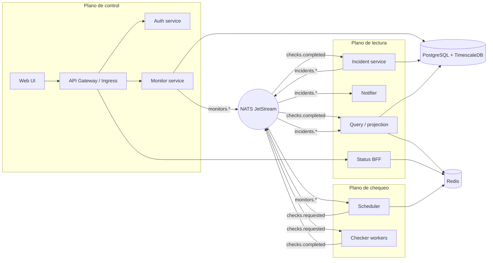
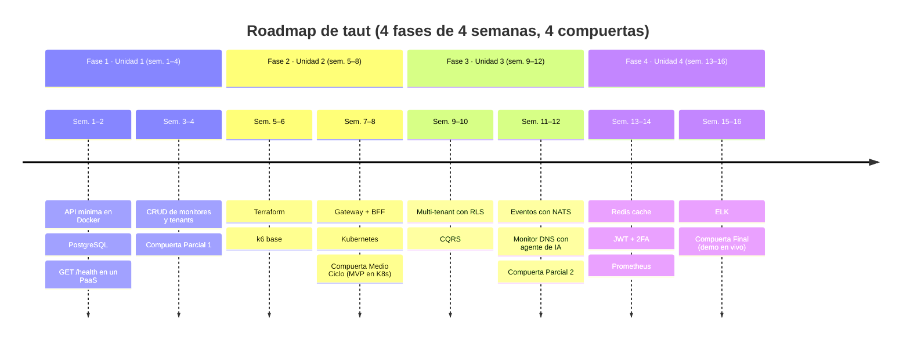

# taut — Documento base del proyecto

> Origen: el documento de Drive "Uptime — Documento base del proyecto" (14 de octubre de 2026,
> Frank Rivera), traído al repositorio el 15 de octubre de 2026 con el proyecto ya renombrado a
> **taut**. Las decisiones tomadas desde entonces viven en los [ADRs](adr/README.md); donde
> cambian lo que decía el documento original hay una nota en cursiva.

## Visión y alcance

taut es un servicio SaaS multi-tenant que vigila la disponibilidad de sitios, APIs y servidores, y
avisa cuando algo cae. Cumple el producto obligatorio del curso (aplicación desplegada en la nube) y
sirve de hilo conductor para las 4 unidades del sílabo IS04E104.

**Lo que hace (MVP, hasta el Examen de Medio Ciclo, semana 8)**

- Un usuario crea una organización (tenant) y registra monitores: HTTP(S), TCP, ping ICMP, DNS y
  palabra clave en el body.
- Workers revisan cada monitor en su intervalo (20 s a 5 min) desde uno o más puntos de prueba.
- Se guarda el historial de latencia y estado; se calcula uptime del día, semana y mes.
- Cuando un monitor cambia de estado (UP → DOWN → UP) se abre o cierra un incidente y se notifica
  por correo, Telegram o Discord.
- Cada tenant publica una página de estado pública con sus monitores e incidentes.

**Lo que agrega después (semanas 9 a 16)**

- CQRS y eventos para separar escrituras (resultados de chequeos) de lecturas (dashboards y páginas
  de estado).
- Caché Redis, autenticación JWT + 2FA, observabilidad con Prometheus y ELK, despliegue en
  Kubernetes.

**Fuera de alcance:** facturación, monitoreo de certificados SSL avanzado, app móvil, SLA
contractuales. Si sobra tiempo, el primero en entrar es el aviso de vencimiento de certificados.

Referencias de producto: [Uptime Kuma](https://github.com/louislam/uptime-kuma) (self-hosted) y
[Better Stack](https://betterstack.com/uptime) (SaaS).

## Mapa del sílabo a funcionalidades

Cada tema del curso se materializa en una pieza concreta del proyecto; la columna "Entregable" es
lo que se muestra en clase o en el examen de esa semana.

| Sem.  | Tema del sílabo                        | Pieza del proyecto                                                        | Entregable                                  |
| ----- | -------------------------------------- | ------------------------------------------------------------------------- | ------------------------------------------- |
| 1–2   | PaaS, Docker, BD SQL/NoSQL             | API mínima en Docker, PostgreSQL gestionado                               | GET /health desplegado en PaaS              |
| 3–4   | App conectada a BD, Examen Parcial 1   | CRUD de monitores y tenants                                               | Crear monitor desde la UI y verlo en la BD  |
| 5     | Terraform                              | Módulo IaC: red, BD, registro de contenedores                             | terraform apply levanta todo desde cero     |
| 6     | Pruebas de carga                       | Script k6 contra la API y la página de estado                             | Reporte p95 / RPS con y sin caché           |
| 7     | API REST, Load Balancer, BFF           | API Gateway + BFF para la página de estado pública                        | Ruta pública balanceada entre 2 réplicas    |
| 8     | Kubernetes, Examen Medio Ciclo         | Manifiestos K8s (Deployment, Service, Ingress, HPA)                       | MVP corriendo en un clúster                 |
| 9     | Multi-tenant                           | Aislamiento por tenant_id + Row-Level Security                            | Dos tenants no ven datos ajenos             |
| 10    | CQRS                                   | Comando RegistrarResultado, proyección ResumenUptime                      | Lecturas desde modelo de consulta           |
| 11    | Microservicios por eventos, reactivo   | Bus de eventos (NATS) entre checker, incidentes y notificaciones          | Alerta llega sin que la API bloquee         |
| 12    | Dev con IA agéntica, Examen Parcial 2  | Generar un tipo de monitor nuevo (DNS) con agente                         | PR revisado y mergeado por CI               |
| 13    | Redis cache                            | Caché de página de estado y de últimos resultados                         | p95 baja respecto a la semana 6             |
| 13–14 | JWT, 2FA, Signature Request            | Auth service con JWT de corta vida + refresh, TOTP, webhooks firmados HMAC | Login con 2FA; webhook verificado           |
| 14    | Prometheus                             | Métricas checks_total, check_latency_seconds, monitors_down               | Dashboard en Grafana                        |
| 15    | ELK, rastreo de logs                   | Logs JSON con trace_id; búsqueda de un incidente de punta a punta         | Seguir un chequeo fallido en Kibana         |
| 16    | Examen Final y proyecto                | Sistema completo en K8s con IaC y CI/CD                                   | Presentación y demo en vivo                 |

## Arquitectura de alto nivel

El sistema separa tres planos: el plano de control (API y UI, lo que el usuario toca), el plano de
chequeo (workers que hacen las peticiones y publican resultados) y el plano de lectura
(proyecciones, caché y página de estado pública). Se comunican por un bus de eventos; la API nunca
ejecuta un chequeo ni envía una alerta en línea.



*Arquitectura: 3 planos, 10 servicios, bus de eventos.* El plano de control escribe en PostgreSQL
y publica eventos; el scheduler y los checkers solo hablan con el bus; incidentes, proyecciones y la
página de estado se alimentan de él. Las flechas entre bus y planos son bidireccionales donde el
servicio consume y publica.

| Componente                  | Responsabilidad                                                                                      | Escala                            |
| --------------------------- | ---------------------------------------------------------------------------------------------------- | --------------------------------- |
| Web UI                      | SPA del panel: monitores, incidentes, configuración del tenant                                       | Estática en CDN                   |
| API Gateway / Ingress       | TLS, rate limit por tenant, enrutamiento a servicios                                                 | 1 por clúster                     |
| Auth service                | Registro, login, JWT + refresh, TOTP 2FA, API keys                                                   | 2 réplicas                        |
| Monitor service (comandos)  | CRUD de monitores, tenants, canales de alerta; publica `monitors.created` / `monitors.updated`       | 2 réplicas                        |
| Scheduler                   | Lee monitores activos y encola `checks.requested` cada intervalo                                     | 1 líder (lock en Redis)           |
| Checker workers             | Ejecutan HTTP/TCP/ping/DNS, publican `checks.completed`                                              | N, por región; HPA por cola       |
| Incident service            | Detecta cambios de estado (3 fallos seguidos = DOWN), abre/cierra incidentes, emite `incidents.opened` | 2 réplicas                        |
| Notifier                    | Suscribe a incidentes y envía correo, Telegram, Discord, webhook firmado                             | 2 réplicas                        |
| Query / projection service  | Proyecta resultados a `uptime_daily` y a los últimos 100 chequeos; sirve dashboards                  | 2 réplicas                        |
| Status BFF                  | Página de estado pública por tenant, respuesta cacheada en Redis                                     | 2 réplicas tras balanceador       |
| Bus de eventos              | NATS JetStream: tópicos `checks.*`, `incidents.*`, `monitors.*`                                      | 3 nodos                           |
| PostgreSQL                  | Tenants, usuarios, monitores, incidentes, canales                                                    | 1 primario + réplica de lectura   |
| TimescaleDB (en PostgreSQL) | Resultados de chequeos crudos, retención 90 días. *Antes MongoDB, ver [ADR 0002](adr/0002-timescaledb-en-postgresql.md)* | Hypertable en el mismo primario   |
| Redis                       | Caché, lock del scheduler, rate limit, sesiones                                                      | 1 + réplica                       |
| Prometheus + Grafana, ELK   | Métricas y logs de todos los servicios                                                               | Namespace observability           |

## Modelo de datos y almacenamiento

*Nota (15-10-2026): el documento original proponía MongoDB para los resultados crudos. La decisión
final es TimescaleDB dentro del mismo PostgreSQL ([ADR 0002](adr/0002-timescaledb-en-postgresql.md)); el
texto de MongoDB se conserva como referencia del diseño.*

Tres almacenes, cada uno con un trabajo: PostgreSQL para lo que se edita (configuración), la
hypertable de TimescaleDB para lo que solo se agrega (resultados), Redis para lo que se lee mil
veces (caché y locks). Esto cubre la Unidad 1 (SQL y NoSQL) y la Unidad 4 (Redis).

**PostgreSQL — configuración y estado del negocio**

| Tabla          | Campos clave                                                                       | Notas                                           |
| -------------- | ---------------------------------------------------------------------------------- | ----------------------------------------------- |
| tenants        | id, slug, plan, created_at                                                         | slug es la URL de la página de estado           |
| users          | id, tenant_id, email, password_hash, totp_secret, role                             | Un usuario pertenece a un tenant                |
| monitors       | id, tenant_id, type, target, interval_s, timeout_s, expected_status, keyword, active | type ∈ http, tcp, ping, dns, keyword            |
| incidents      | id, tenant_id, monitor_id, started_at, resolved_at, cause                          | Abierto = resolved_at IS NULL                   |
| alert_channels | id, tenant_id, kind, config_json, secret                                           | kind ∈ email, telegram, discord, webhook        |
| uptime_daily   | monitor_id, day, checks, failures, avg_latency_ms                                  | Proyección CQRS, se reconstruye desde los resultados crudos |

Todas las tablas con datos de negocio llevan tenant_id y una política de Row-Level Security
(`SET app.tenant_id`) para que un error de código no filtre datos entre tenants.

**Resultados crudos (append-only)**

Diseño original en MongoDB:

```json
{ "monitorId": "m_01HX…", "tenantId": "t_7f…", "at": "2026-10-14T15:00:20Z",
  "region": "sa-east-1", "ok": true, "status": 200, "latencyMs": 183,
  "error": null, "traceId": "4bf92f…" }
```

Índice compuesto `{monitorId: 1, at: -1}` y un índice TTL de 90 días sobre `at`. A 1 000
monitores cada 60 s son 1,4 M documentos/día (~250 MB/día); el TTL mantiene la colección acotada.

*Con TimescaleDB la misma estructura es una hypertable `check_results(monitor_id, tenant_id, at,
region, ok, status, latency_ms, error, trace_id)` particionada por `at`, con una política de
retención de 90 días y agregados continuos para `uptime_daily`.*

**Redis — caché y coordinación**

| Clave               | Contenido                           | TTL              |
| ------------------- | ----------------------------------- | ---------------- |
| status:{slug}       | JSON de la página de estado pública | 30 s             |
| monitor:{id}:last   | Últimos 50 resultados               | 5 min            |
| lock:scheduler      | Lock de líder del scheduler         | 10 s, renovado   |
| rl:{tenant}:{min}   | Contador de rate limit              | 60 s             |
| session:{jti}       | Refresh tokens revocables           | 7 d              |

## Patrones aplicados

Cuatro patrones del sílabo (Unidad 3) tienen un lugar natural en un sistema de monitoreo; aquí
está la decisión de cada uno y por qué.

**Multi-tenant (sem. 9).** Modelo *shared database, shared schema*: una sola BD, columna tenant_id
en cada tabla, aislamiento por Row-Level Security en PostgreSQL (también en la hypertable de
resultados). El tenant_id viaja dentro del JWT y se inyecta en cada consulta por middleware; ningún
handler lo recibe como parámetro del cliente. Es el modelo más barato de operar y el que mejor se
demuestra en una demo con dos tenants.

**CQRS (sem. 10).** El lado de escritura recibe comandos (CrearMonitor, RegistrarResultado,
AbrirIncidente) y publica eventos. El lado de lectura mantiene proyecciones desnormalizadas
(uptime_daily, monitor:{id}:last en Redis, página de estado) que se reconstruyen reproduciendo los
eventos. Las proyecciones son desechables: borrar uptime_daily y reprocesar los resultados crudos es
la prueba de que el patrón está bien hecho.

**Microservicios basados en eventos (sem. 11).** El bus (NATS JetStream) desacopla checker →
incidentes → notificaciones. Un checker caído no detiene la API; un notificador lento no retrasa la
detección. Los consumidores son idempotentes (clave monitorId + at) porque JetStream entrega al
menos una vez.

| Evento                                   | Productor         | Consumidores                           |
| ---------------------------------------- | ----------------- | -------------------------------------- |
| monitors.created / monitors.updated      | Monitor service   | Scheduler                              |
| checks.requested                         | Scheduler         | Checker workers (cola de trabajo)      |
| checks.completed                         | Checker workers   | Incident service, Projection service   |
| incidents.opened / incidents.resolved    | Incident service  | Notifier, Projection service           |
| notifications.sent / notifications.failed | Notifier         | Projection service (historial)         |

**Backend reactivo (sem. 11).** El checker usa I/O asíncrono: un worker mantiene cientos de
chequeos HTTP en vuelo con un solo hilo por núcleo. El dashboard recibe resultados nuevos por
Server-Sent Events en lugar de polling.

**Lo que NO se aplica:** Event Sourcing completo (la tabla de resultados ya es el log de hechos),
sagas (no hay transacciones distribuidas que compensar) y service mesh (sobra para 8 servicios).

## Stack tecnológico y tooling

Un solo lenguaje de backend para todos los servicios (menos Dockerfiles, un solo CI) y un frontend
ligero.

*Nota (15-10-2026): respecto al documento original cambian la BD NoSQL (TimescaleDB en vez de
MongoDB), el gestor JS (bun en vez de npm), el task runner (just en vez de Makefile), el linter y
formateador del frontend (oxlint y oxfmt en vez de ESLint y Prettier) y los hooks (lefthook con
Conventional Commits). Rust queda confirmado como único backend. Ver ADRs
[0001](adr/0001-monorepo-cargo-workspace-rust.md), [0002](adr/0002-timescaledb-en-postgresql.md) y
[0003](adr/0003-tooling-just-lefthook-bun-oxc.md).*

| Capa              | Elección principal                                                                                           | Alternativa                     | Por qué                                                                                       |
| ----------------- | ------------------------------------------------------------------------------------------------------------ | ------------------------------- | --------------------------------------------------------------------------------------------- |
| Backend / API     | Rust: [Axum](https://github.com/tokio-rs/axum) + tokio, sqlx, async-nats, redis-rs                           | TypeScript: Fastify + Prisma    | El checker es I/O intensivo; tokio sostiene miles de chequeos concurrentes por réplica con poca memoria |
| Frontend          | SvelteKit + TypeScript, Tailwind; bun, oxlint y oxfmt                                                        | Next.js                         | Panel pequeño; SvelteKit compila a estático para servir desde CDN                            |
| BD relacional     | PostgreSQL 17                                                                                                | —                               | Row-Level Security nativa para multi-tenant                                                   |
| Series de tiempo  | TimescaleDB (hypertable en el mismo PostgreSQL)                                                              | MongoDB 7                       | Append-only con retención por política; una sola BD que operar                               |
| Caché / locks     | Redis 7                                                                                                      | Valkey                          | Unidad 4 lo pide por nombre                                                                   |
| Bus de eventos    | NATS JetStream                                                                                               | RabbitMQ, Redis Streams         | Un binario, persistencia, colas de trabajo y pub/sub en el mismo sistema                     |
| Contenedores      | Docker, imágenes multi-stage con cargo-chef (rust slim → debian:bookworm-slim)                               | —                               | Imagen final pequeña por servicio, dependencias cacheadas                                     |
| Orquestación      | Kubernetes: k3d en local, clúster gestionado en la nube                                                      | Docker Compose solo hasta sem. 7 | Sílabo sem. 8, 19 y 21                                                                        |
| IaC               | Terraform 1.9+ + proveedor de la nube + proveedor kubernetes y helm                                          | OpenTofu                        | Unidad 1 y la investigación formativa                                                         |
| CI/CD             | GitHub Actions: lint, test, build, push a registry, kubectl apply                                            | GitLab CI                       | Alineado al paper del docente (Pando, 2025)                                                   |
| Pruebas de carga  | [k6](https://k6.io)                                                                                          | Locust                          | Scripts en JS versionados junto al código; exporta a Prometheus                              |
| Observabilidad    | Prometheus + Grafana (kube-prometheus-stack), ELK (Filebeat → Elasticsearch → Kibana), OpenTelemetry para trace_id | Loki en vez de ELK          | Sílabo sem. 29–31 pide Prometheus y ELK por nombre                                           |
| Auth              | JWT (RS256, 15 min) + refresh (7 d), TOTP RFC 6238, webhooks firmados HMAC-SHA256                             | OAuth con Google                | Unidad 4                                                                                      |
| Dev con IA        | Claude Code / Copilot con un AGENTS.md por repo que fija convenciones                                         | —                               | Sem. 24: tarea de agregar un tipo de monitor con agente                                       |
| Tooling de equipo | just, lefthook + Conventional Commits, cargo-nextest, cargo-deny, Dependabot                                  | Makefile, pre-commit            | Un punto de entrada y feedback antes del commit                                               |

**Nube.** El clúster gestionado es el mayor costo del proyecto. Cualquiera de las tres sirve; la
decisión se toma la semana 2 según créditos disponibles.

| Proveedor          | K8s gestionado | Costo aprox. del clúster mínimo                                   | Nota                                                       |
| ------------------ | -------------- | ----------------------------------------------------------------- | ---------------------------------------------------------- |
| Oracle Cloud (OCI) | OKE            | 0 USD con Always Free (4 OCPU Arm, 24 GB)                         | La opción más barata; imágenes deben compilarse para arm64 |
| Azure              | AKS            | ~70 USD/mes (2 nodos B2s); créditos de estudiante 100 USD         | Plano de control gratis                                    |
| AWS                | EKS            | ~140 USD/mes (plano de control 0,10 USD/h + nodos)                | El más caro; usar solo si el equipo ya tiene créditos      |

**Repositorio.** Monorepo con `crates/` (código compartido), `services/<nombre>`, `web/`,
`infra/terraform`, `infra/k8s`, `loadtest/`, `.github/workflows`. Un `justfile` con `just up`
(infraestructura local), `just test`, `just loadtest` y el resto de recetas (`just --list`).

## Infraestructura, despliegue y CI/CD

Todo lo que corre en la nube nace de `terraform apply` y se actualiza con un `git push` a main;
nada se crea a mano en la consola del proveedor.

**Entornos**

| Entorno | Dónde                                                       | Para qué                                        |
| ------- | ----------------------------------------------------------- | ----------------------------------------------- |
| local   | k3d en la laptop (Docker Compose solo para BDs en sem. 1–7) | Desarrollo diario, `just up`                    |
| staging | Namespace taut-staging en el clúster                        | Cada merge a main; demos en clase               |
| prod    | Namespace taut-prod                                         | Tag v*; aprobación manual en GitHub Environments |

**Terraform (sem. 5)** en `infra/terraform`, con backend remoto para el estado (bucket del
proveedor + lock):

1. network: VPC / VCN, subredes, security groups.
2. cluster: Kubernetes gestionado con 2 nodos y autoescalado a 4.
3. data: PostgreSQL gestionado (con TimescaleDB), Redis.
4. registry: registro de contenedores privado.
5. addons (proveedor helm): ingress-nginx, cert-manager, NATS, kube-prometheus-stack, ELK.

**Kubernetes (sem. 8)** en `infra/k8s` con Kustomize (`base/` + `overlays/staging`,
`overlays/prod`): un Deployment + Service por microservicio, HorizontalPodAutoscaler para los
checker workers (métrica: profundidad de la cola checks.requested), Ingress con TLS de Let's
Encrypt, NetworkPolicy que solo deja a los servicios hablar con sus BDs, secretos desde el gestor
del proveedor vía External Secrets.

**Pipeline (GitHub Actions)**

| Disparador     | Job            | Qué hace                                                                                         |
| -------------- | -------------- | ------------------------------------------------------------------------------------------------ |
| Pull request   | ci             | cargo fmt --check, cargo clippy, cargo deny, cargo nextest, bun run lint/check/test/build; levanta Postgres (TimescaleDB) como servicio para tests de integración |
| Pull request   | plan           | terraform plan y comenta el diff en el PR                                                        |
| Merge a main   | build          | Build multi-stage, push ghcr.io/<org>/<svc>:<sha>, firma con cosign                              |
| Merge a main   | deploy-staging | kustomize edit set image + kubectl apply -k overlays/staging; smoke test GET /health             |
| Tag v*         | deploy-prod    | Igual que staging tras aprobación manual                                                         |
| Nightly        | loadtest       | k6 contra staging; falla si p95 > 300 ms                                                         |

El rollback es `kubectl rollout undo` o volver a aplicar el tag anterior; las migraciones de BD van
en un Job previo al despliegue y son siempre compatibles hacia atrás (expand → migrate → contract).

## Seguridad: autenticación y autorización

Tres identidades distintas entran al sistema y cada una tiene su mecanismo: personas (JWT + 2FA),
integraciones del cliente (API keys) y el propio sistema hacia afuera (webhooks firmados). Cubre las
sesiones 27 y 28 del sílabo.

| Quién                      | Mecanismo                                                              | Vida            | Dónde se valida                                                                           |
| -------------------------- | ---------------------------------------------------------------------- | --------------- | ----------------------------------------------------------------------------------------- |
| Usuario en el panel        | Access JWT RS256 con sub, tenant_id, role, jti                         | 15 min          | Cada servicio verifica firma con la clave pública del auth service (JWKS); sin llamada de red |
| Usuario, sesión larga      | Refresh token opaco guardado en Redis (session:{jti}), rotación en cada uso | 7 días      | Solo el auth service; revocable                                                           |
| Segundo factor             | TOTP RFC 6238, secreto cifrado en users.totp_secret, 8 códigos de respaldo | —           | Auth service en el login y al cambiar canales de alerta                                   |
| Integración (CI del cliente) | API key up_live_…, hash en BD, scope de solo lectura o escritura     | Hasta revocar   | Gateway, cabecera Authorization: Bearer                                                   |
| Webhook saliente           | Cabecera X-Taut-Signature: t=<ts>,v1=<HMAC-SHA256(secret, ts.body)>    | Ventana de 5 min | El cliente la verifica; evita replay                                                     |

**Autorización.** Dos roles por tenant: owner (gestiona usuarios, canales y facturación futura) y
member (gestiona monitores). La página de estado pública no requiere sesión; se sirve desde el BFF
con el slug del tenant y nunca expone targets internos ni IPs.

**Controles transversales**

- Contraseñas con Argon2id; límite de 5 intentos por 15 min por cuenta e IP (Redis).
- Rate limit por tenant en el gateway: 60 req/min en el plan gratuito.
- Validación de targets: los monitores no pueden apuntar a rangos privados (10/8, 172.16/12,
  192.168/16, 169.254/16) ni a localhost; evita usar el sistema para escanear la red interna del
  clúster.
- Secretos solo vía Kubernetes Secrets desde External Secrets; ninguno en el repo ni en imágenes.
- Cabeceras HSTS, CSP y CORS restringido al dominio del panel.

## Observabilidad y pruebas de carga

Un sistema de uptime que no mide su propio uptime no es creíble: cada servicio expone `/metrics`,
escribe logs JSON con trace_id y propaga ese id por el bus. Cubre las sesiones 13, 29, 30 y 31.

**Métricas (Prometheus + Grafana)**

| Métrica                       | Tipo      | Etiquetas               | Para qué                                          |
| ----------------------------- | --------- | ----------------------- | ------------------------------------------------- |
| uptime_checks_total           | counter   | type, result, region    | Volumen y tasa de fallos                          |
| uptime_check_latency_seconds  | histogram | type, region            | p50 / p95 de los targets vigilados                |
| uptime_monitors_down          | gauge     | tenant                  | Alerta si sube de golpe (¿caímos nosotros?)       |
| uptime_queue_depth            | gauge     | subject                 | Métrica del HPA de los workers                    |
| uptime_check_lag_seconds      | histogram | —                       | Retraso entre hora programada y ejecutada; SLO interno |
| http_request_duration_seconds | histogram | service, route, status  | Latencia de la API y del BFF                      |

SLOs internos del proyecto: 99,5 % de chequeos ejecutados con lag < 10 s; p95 de la API < 300 ms;
alerta entregada < 60 s después del tercer fallo. Grafana con dos tableros: *Plataforma* (SLOs,
colas, pods) y *Negocio* (monitores por tenant, incidentes abiertos).

**Logs (ELK) y rastreo de un suceso**

Logs en JSON a stdout → Filebeat (DaemonSet) → Elasticsearch → Kibana. Campos fijos: ts, level,
service, tenant_id, monitor_id, trace_id, msg. El trace_id nace en el scheduler al emitir
checks.requested y viaja en la cabecera del mensaje NATS, de modo que la sesión 31 ("rastreo de log
de un suceso") se resuelve con una sola consulta en Kibana: `trace_id:"4bf92f…"` muestra scheduler
→ checker → incident service → notifier en orden.

**Pruebas de carga (k6)** en `loadtest/`, tres escenarios:

1. api-crud.js: 50 usuarios virtuales creando y listando monitores, 5 min. Umbral: p95 < 300 ms,
   errores < 1 %.
2. status-page.js: 500 VUs leyendo páginas de estado públicas. Se corre dos veces: sin caché
   (sem. 6) y con Redis (sem. 13); el delta es el entregable.
3. checker-soak.js: 2 000 monitores sintéticos a 30 s apuntando a un servidor de eco interno,
   30 min. Verifica que uptime_check_lag_seconds se mantenga bajo 10 s y que el HPA escale.

## Roadmap por semanas

Cuatro fases que coinciden con las unidades del sílabo; cada examen es una compuerta con un
criterio verificable. El MVP tiene que estar en Kubernetes para el Examen de Medio Ciclo (semana 8),
porque las unidades 3 y 4 solo agregan capas sobre él.



*Roadmap: 4 fases de 4 semanas, 4 compuertas.* Cada fase ocupa exactamente una unidad del sílabo y
termina en un examen; la fase 2 es la crítica porque las dos siguientes dependen del clúster que
deja listo.

Criterio de cada compuerta:

- **Parcial 1 (sem. 4):** API + UI en Docker en un PaaS; crear un monitor y verlo persistido en
  PostgreSQL.
- **Medio Ciclo (sem. 8):** MVP completo en Kubernetes creado con Terraform; chequeos, incidentes,
  alertas y página de estado funcionando; reporte k6 base.
- **Parcial 2 (sem. 12):** multi-tenant con RLS, CQRS con proyecciones reconstruibles, bus de
  eventos; tipo de monitor DNS agregado con agente de IA vía PR.
- **Final (sem. 16):** 2FA, caché Redis con mejora medida, tableros Grafana, rastreo de un
  incidente en Kibana; demo en vivo y repositorio con CI/CD verde.

## Riesgos y decisiones abiertas

| Riesgo                                                | Impacto                            | Mitigación                                                                                                   |
| ----------------------------------------------------- | ---------------------------------- | ------------------------------------------------------------------------------------------------------------ |
| Costo del clúster gestionado supera los créditos      | No hay entorno de demo en la nube  | Decidir proveedor en sem. 2; OCI Always Free como plan B; k3d local siempre funcional                        |
| Rust alarga el tiempo de desarrollo del CRUD          | MVP no llega a la sem. 8           | Generar scaffolding con IA; si en sem. 3 el CRUD no está, cambiar a TypeScript solo para API y mantener Rust en el checker |
| ELK consume demasiada memoria en un clúster de 2 nodos | Observabilidad inestable          | Elasticsearch de 1 nodo con 1 GB heap; alternativa Loki si no cabe                                           |
| Workers hacen ping ICMP sin privilegios en K8s        | Tipo de monitor ping no funciona   | Capability NET_RAW en el pod del checker o usar TCP connect como sustituto                                   |
| Entrega al menos una vez del bus duplica incidentes   | Alertas repetidas                  | Idempotencia por monitorId + at; estado del monitor en Redis con CAS                                         |
| Scope creep (SSL, móvil, facturación)                 | Nada queda terminado               | Lista "fuera de alcance" en este documento; cambios solo por acuerdo del equipo                              |

**Decisiones pendientes**

- [x] Backend 100 % Rust o Rust solo en checker + TypeScript en API → **Rust 100 %**, decidido el
      15-10-2026 ([ADR 0001](adr/0001-monorepo-cargo-workspace-rust.md)); se revisa en la semana 3
      si el CRUD no avanza.
- [x] MongoDB Atlas M0 o TimescaleDB dentro de PostgreSQL → **TimescaleDB**, decidido el
      15-10-2026 ([ADR 0002](adr/0002-timescaledb-en-postgresql.md)).
- [ ] Proveedor de nube: OCI, Azure o AWS (sem. 2).
- [ ] PaaS para el entregable de la semana 1–2 (Fly.io, Render o Railway).
- [ ] Tamaño del equipo y reparto de servicios (el sílabo trabaja en equipos de 2 en sem. 9 y 10).
- [ ] Dominio para la página de estado pública (status.<dominio>/<slug> o <slug>.status.<dominio>).
- [x] Licencia del repositorio → **MIT**, decidida el 15-10-2026 ([ADR 0006](adr/0006-licencia-mit.md)).
